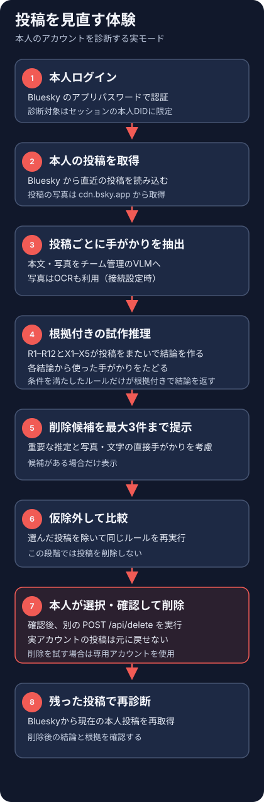
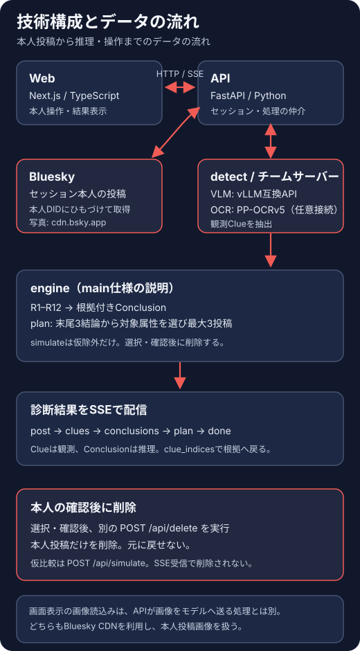
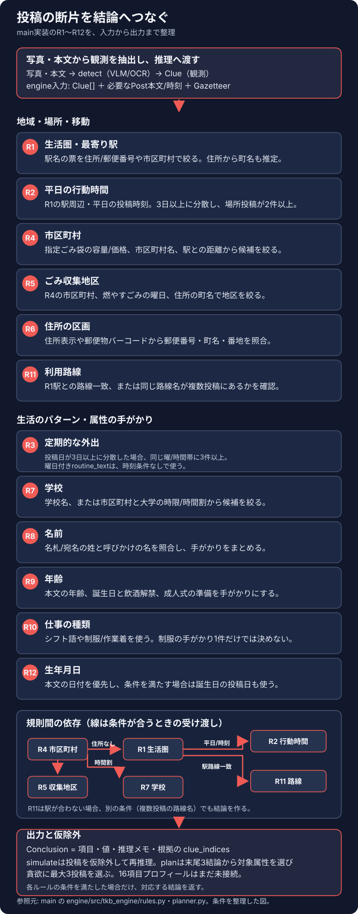

# みーつけた

作品名は「みーつけた」。Bluesky の自分の投稿を横断し、投稿文や写真の手がかりからどのような生活情報が推定されうるかを確かめる Web アプリです。実モードの環境構築と診断手順は[環境構築の手順](docs/setup.md)、実装済みの API とイベントの範囲は[現行 API・SSE 契約](docs/api-sse-contract.md)を参照してください。

## 製品概要
### 背景(製品開発のきっかけ、課題等）
想定する利用者は、住所や本名などをそのまま投稿するつもりはない一方、日常の出来事を写真や短い文章で繰り返し共有する人です。駅や店、投稿時刻、通勤・通学や家族に触れた話題は、単独では断片的でも、投稿履歴を通して見ると生活上の手がかりになりえます。自分の投稿を一件ずつ覚えていても、過去の内容をまとめて読み、どの断片がどう結び付くかを確かめるのは難しい、という課題を出発点にしています。

Hack Day 前は「投稿前に写真 1 枚を塗って隠す」案でした。しかし、その形では一枚の写真の公開前確認に対象が限られ、文章や、別々の時点・投稿に分かれた情報の組み合わせを振り返れません。そこで 1日目に、本人の Bluesky 投稿を横断して、投稿後にも履歴を見直せる案へ転換しました。

危険度をひとつの点数にまとめるだけでは、どの投稿のどの手がかりが推定につながったのかを利用者が確かめられません。根拠となる投稿と結論のつながりを示し、候補投稿を仮に除いた結果も見せることで、誤読や推論の飛躍を見つけたり、削除するかを本人が判断したりできる設計を目指します。削除候補を少数に絞るのは、履歴全体を消す負担を避けながら、何を見直すと推定が変わるかを確認できるようにするためです。

対象をログインした本人のアカウントに限るのは、自分の投稿を見直す道具として設計し、ハンドル名から他人を調べる用途に広げないためです。成果は、削除した投稿の件数と、削除前にあった推定が削除後にどう変わったかで捉える方針です。これは行動とその後の変化を見るための指標案であり、実測した効果や精度を示すものではありません。
### 製品説明（具体的な製品の説明）
利用者が自分の Bluesky アカウントにログインすると、API が本人の投稿を取得し、各投稿から観測できる手がかりを集めます。推理結果には、根拠として使った手がかりを結び付けます。削除候補を選んだ後は、実際に削除する前に仮に取り除いた結果を確認できます。Bluesky からの削除は、利用者が選択し、確認ダイアログで確定した場合に限ります。

写真と投稿本文は第三者の AI サービスへ送らず、チーム管理下のモデルサーバーで解析します。診断結果はディスクやログに保存せず、仮除外に使う投稿と手がかりだけを API のセッションメモリに一時保持し、ログアウト・セッション期限切れ・次の診断開始時に破棄します。診断できるのは、ログインした本人の投稿だけです。

GitHub の main にある[engine 実装（7f46e5b）](https://github.com/jphacks/tkb_2613/tree/7f46e5bb8bfb0f97800552c3464a726d00191e15/engine)は R1〜R12 の試作ルールで結論を作ります。各結論は `clue_indices` で根拠へ戻れます。`plan` は実際に得られた結論リストの末尾 3 件から対象属性を決め（重複は除外）、結論と根拠が減る投稿を貪欲に選び、最大 3 件を提案します。プロフィール 16 項目を `found / weak / unknown` と確度・根拠でまとめる形式は未接続です。規則の条件と接続関係は[推理ルールの図](docs/images/inference-rules.svg)にまとめました。
### 特長
#### 1. 特長1
投稿を一件ずつ独立に判定するのではなく、写真と本文から得た手がかりを投稿をまたいで確認します。手がかりは「何が見えたか・何が書かれていたか」という観測として扱い、職業や住所などの推論そのものとは分けています。
#### 2. 特長2
結論から使われた手がかりへ戻れるよう、同じ診断内の手がかり番号を根拠として保持します。これにより、モデルやルールの誤読を事実のように扱わず、推定のどこに根拠があるかを利用者が確かめられます。推定は断定ではなく、本人の特定や安全を保証するものでもありません。
#### 3. 特長3
投稿を大量に消すよう促すと、必要な記録まで失わせ、行動の負担も増やします。そこで、現在の試作推理で重要な結論を弱める候補を最大 3 件まで示し、選んだ投稿を仮に除いた場合の結果を先に表示します。実削除は利用者が確認したときだけ行い、削除後は残った投稿で診断し直せます。

以下は、現行実装に基づく診断体験の説明図です（画面キャプチャではなく、実装範囲を示す編集可能な SVG 図です）。

### 解決出来ること
SNS投稿を重ねる人が、無意識に投稿した写真や文面も、組み合わさると個人を特定する手がかりになりうると気づき、どんな投稿が個人情報の特定につながるかを学ぶ支援を目指します。削除候補として示された投稿と、その候補に至った推理の根拠・過程を見直すことで、次に何を投稿するか、どの情報を伏せるかを自分で考える材料にします。
### 今後の展望
main の R1〜R12 は試作で、プロフィール 16 項目との対応づけや、実投稿を使った妥当性・精度の検証は未完了です。専用デモアカウントで根拠と削除前後を確かめ、生活パターンの推定を含む規則を検証・改善します。別サイトを開く負担を減らすため、診断機能を SNS 内に組み込む構想です。また、現在サイト内で行える投稿削除に加え、削除以外の SNS 操作もこのサイトから直接行えるようにすることを目指します。
### 注力したこと（こだわり等）
* 写真・本文から手がかりを抽出するときは、チームが管理するクラウド上の vLLM サーバーを使い、第三者の AI サービスの推論 API へ送りません。main の推理は抽出した手がかりに R1〜R12 のルールを適用して結論を組み立てます。診断結果はディスクやログに保存せず、仮比較に使う本人投稿と手がかりだけを API のセッションメモリに一時保持し、ログアウト・期限切れ・次の診断開始時に破棄します。
* 観測（投稿で見えた情報）と推理（そこから導いた仮説）を分け、根拠の投稿に戻って確かめられること。
* 診断対象をログイン本人の投稿に限り、削除は本人が選択・確認した後にだけ実行し、モデルに操作権限を渡さないこと。推定は断定ではなく、安全を保証するものでもありません。

## 開発技術
### 活用した技術
#### API・データ
* Bluesky の本人認証と本人投稿取得は Python API が担当します。ブラウザから Bluesky へ直接接続せず、本人の DID にひも付くセッションで対象を限定します。
* FastAPI は投稿一覧、投稿ごとの手がかり、結論、候補プランを Server-Sent Events で順に配信します。手がかりは共通 Pydantic 型で受け渡し、推理結果は根拠となる手がかり番号を持ちます。
* 画像・本文の抽出器はチーム管理下の vLLM（OpenAI 互換 API）を利用し、OCR は PP-OCRv5 の HTTP サービスを接続設定した場合に利用します。既知の第三者 AI サービスを拒否するガードがあります。API は `cdn.bsky.app` から本人投稿の画像を取得します。
* `data-prep/` は駅などの公開データを取得・変換します。データ本体はコミットしません。駅名候補を確認するデータが必要な場合は `make data` で準備します。

次の図は Web・API・抽出器・推理 engine の境界と、投稿や手がかりの流れを示します。実装範囲を説明する編集可能な SVG 図であり、稼働画面のキャプチャではありません。

#### フレームワーク・ライブラリ・モジュール
* Web：Next.js App Router、React、TypeScript、Tailwind CSS
* API と共通型：Python、FastAPI、Pydantic、`common/` の共有スキーマ
* 手がかり抽出：OCR・VLM クライアント、投稿単位の抽出パイプライン
* 推理・評価：決定的な試作ルール、最大 3 投稿の貪欲な候補選定、pytest、Vitest、ruff、mypy、ESLint、TypeScript 型検査、GitHub Actions

#### デバイス
* Web ブラウザが動く PC。Windows は WSL2 上の Ubuntu を推奨します。診断には Bluesky アカウントとチーム管理下の VLM サーバーが必要です。

### 独自技術
#### ハッカソンで開発した独自機能・技術
* 投稿を取得して診断するパイプラインは [`api/src/tkb_api/pipeline.py`](api/src/tkb_api/pipeline.py)、推理ルールは `engine/src/tkb_engine/rules.py`、仮比較と候補選定は `engine/src/tkb_engine/planner.py` にあります。main の参照先は上記の固定コミットです。
* API の SSE 契約、候補提示、仮除外、実削除の入力条件は[現行 API・SSE 契約](docs/api-sse-contract.md)、画面側の診断と根拠表示は [`web/src/components/diagnose/DiagnosePanel.tsx`](web/src/components/diagnose/DiagnosePanel.tsx) と [`web/src/components/conclusion-board/ConclusionBoard.tsx`](web/src/components/conclusion-board/ConclusionBoard.tsx) を参照してください。
* main の R1〜R12 は手がかりと知識表を使う明示的なルールです。たとえば R4 は指定ゴミ袋の容量・価格や市区町村名、駅との距離の手がかりから市区町村を絞り、R4 の結果を使う R5 はごみ収集日の掲示と町名から収集地区を絞ります。R1 は駅名や住所・郵便番号から生活圏を推定し、R4 の市区町村で駅候補を絞ります。R2/R3 は投稿時刻や曜日の反復、R6 は住所・郵便バーコード、R7 は学校名や市区町村と時間割、R8〜R12 は名前・年齢・仕事・路線・生年月日の手がかりを扱います。各結論は根拠の手がかり番号を持ちます。
* 以下の図は main の `rules.py` と `planner.py` を読むための説明です。

* `simulate` は指定投稿を仮に除いた手がかりと投稿から同じルールを再実行します。`plan` はその時点で存在する結論リストの末尾 3 件から対象属性を決め（重複は除外）、結論数と根拠数が減る候補投稿を順に選び、最大 3 件で止めます。これは全属性を対象にした最小解の探索ではなく、試作の貪欲な選び方です。プロフィール 16 項目の目標形式は未接続です。
* 実削除は取り消せません。画面で選択し、確認ダイアログで確定した投稿だけを本人の Bluesky アカウントから削除します。
* Hack Day 前に用意した土台は、リポジトリ・開発環境、共通の手がかり形式、モック API と画面の骨組み、OCR/VLM クライアントと安全ガード、公開データ変換です（一覧は[事前開発の記録](docs/pre-hackday.md)を参照）。Hack Day 中には、Bluesky の本人ログイン・投稿取得、投稿横断の手がかりと推理、SSE 配信、候補の仮除外、確認後の削除を実装しました。
