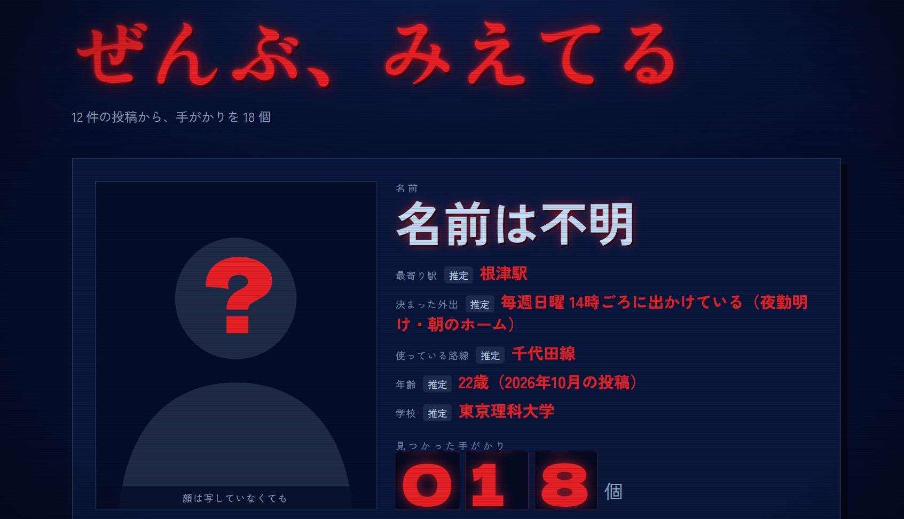

# みーつけた

**その投稿、組み合わせると、どこまで分かる？**

「みーつけた」は、Blueskyの自分の投稿を横断し、写真や文章の手がかりから、どのような生活情報が推定されうるかを確かめるWebアプリです。

推定結果と根拠を確認し、投稿を仮に取り除いた場合の変化を比較できます。その結果を見て、本人が投稿を削除するかを判断できます。

実モードの環境構築と診断手順は[環境構築の手順](docs/setup.md)、APIとイベントの詳細は[現行 API・SSE 契約](docs/api-sse-contract.md)を参照してください。

## 製品概要

### 背景（製品開発のきっかけ、課題等）

住所や本名を直接投稿していなくても、写真に写った駅名や店名、何気なく書いた生活上の出来事が、別の投稿と結び付くことで個人情報の手がかりになることがあります。

自分の投稿を一件ずつ覚えていても、過去の履歴をまとめて読み、どの情報がどう結び付くかを確認するのは簡単ではありません。また、危険だと分かっても、どの投稿を見直せばよいか判断できなければ、具体的な対策にはつながりません。

そこで、「投稿の組み合わせから何が分かるか」と「どの投稿を見直すと推定が崩れるか」を、本人が確かめられる仕組みを作りました。

Hack Day前は「投稿前の写真1枚を塗って隠す」案でしたが、1日目に、写真と文章を含む投稿履歴全体を振り返る現在の形へ転換しました。

### 製品説明（具体的な製品の説明）

利用者が自分のBlueskyアカウントにログインすると、本人の投稿を取得し、写真と本文から手がかりを抽出します。推理エンジンは、手がかりを公開データや知識表と照合し、投稿をまたいで組み合わせます。

現在はR1〜R12のルールを実装し、居住エリア、利用駅・路線、通学先、名前、年齢・生年月日、仕事や生活パターンなどに関する推定を行います。結果には根拠となる手がかりを結び付け、元の投稿を確認できるようにしています。

削除候補を選ぶと、実際に消す前に、その投稿を仮に除いた結果を確認できます。Blueskyからの削除は、本人が投稿を選び、確認ダイアログで確定した場合だけ実行します。削除後は、残った投稿で診断し直せます。

### 特長

#### 1. 一件では分からないことを、投稿の組み合わせから示す

写真と本文を一件ずつ独立に判定するのではなく、投稿をまたいで手がかりを照合します。

例えば、指定ごみ袋の容量・価格から得られる地域の候補と、別の投稿にある距離の情報を組み合わせて候補を絞ります。単独では断片的な情報が、どのように結論につながるかを示します。

#### 2. 推定結果から、根拠の投稿へ戻れる

「何が見えたか・何が書かれていたか」という観測と、そこから導いた推理を分けています。

結論には根拠の手がかりを保持するため、利用者は推定の理由を確認できます。実情と異なる推定が出た場合も、読み取りの誤りや推論の飛躍を確かめる材料になります。

#### 3. 消す前に、対策の効果を比較できる

削除候補を仮に取り除き、残った手がかりで推理し直します。履歴全体を消すのではなく、どの投稿を見直すと対象の推定が成立しなくなるかを確認できます。

候補は最大3投稿まで提示します。実削除は本人の確認後に限り、モデルが自動で投稿を削除することはありません。

以下は、診断体験の流れを示す説明図です。画面キャプチャではなく、構成を説明するSVG図です。

### 解決出来ること

**自分の投稿履歴から、どのような情報が推定されうるかを確認できます。**

日常の写真や何気ない文章をまとめて振り返り、個々の投稿では気づきにくい情報のつながりを可視化します。

**推定につながった投稿を把握し、具体的な対策を選べます。**

結論と根拠の対応、投稿を仮に除いた場合の変化を確認し、必要な記録をできるだけ残しながら、どの投稿を見直すかを判断できます。

**今後の情報発信を考える材料になります。**

実際にどの手がかりが結び付いたかを見ることで、次に写真を載せるときに何を隠すか、文章のどこまでを具体的に書くかを、自分で考えるきっかけを作ります。

### 今後の展望

今回目指した「投稿を横断して推定し、根拠を確認し、対策前後を比較する」という一連の体験を実装できました。今後は実際の利用を通じて、推定の妥当性と操作の分かりやすさを磨いていきます。また、Blueskyに加え、XやInstagramなど主要SNSへの対応も検討しています。より多くの人が、普段使っているSNSの投稿から個人情報の露出に気づき、対策を選べるサービスへ広げていきます。

さらに、推定された個人情報が現実世界でどのように悪用されうるか、具体的なシナリオを提示する機能を検討しています。例えば、生活圏や定期的な外出の情報が、待ち伏せや不在時間を狙った被害につながる可能性を、自分の診断結果と結び付けて示します。ユーザーが情報の露出を「自分ごと」として捉え、対策の必要性を強く感じられる体験を目指します。

### 注力したこと（こだわり等）

* **組み合わせの過程を説明できること。** 手がかりの抽出と推理を分離し、結論は明示的なルールで組み立てます。結果だけでなく、どの投稿のどの情報が使われたかを確認できるようにしました。

* **対策の前後を同じ条件で比較できること。** 仮除外では、抽出済みの手がかりから対象投稿の分を取り除き、同じルールを再実行します。候補選定と再計算には言語モデルを使いません。

* **投稿の事情に合わない推定を抑えること。** 同じ日にまとめて投稿された履歴では、投稿時刻が生活のリズムを表すとは限らないため、時刻を使う推理を抑制します。バーコードも画像処理で読み取り、モデルが推測した中身を住所の区画の根拠にしないようにしています。

* **本人が情報の扱いを決められること。** 診断対象はログインした本人の投稿に限定します。削除は本人の選択・確認後にだけ実行し、モデルには操作権限を渡しません。

* **解析するデータの扱いを限定すること。** 写真・本文のモデル解析にはチーム管理下のサーバーを使い、第三者のAIサービスの推論APIには送りません。投稿と手がかりはAPIのセッションメモリに一時保持し、ログアウト・期限切れ・次の診断開始時に破棄します。

## 開発技術

### 活用した技術

#### API・データ

* Bluesky：本人認証、本人投稿の取得、本人が確認した投稿の削除
* FastAPI・Server-Sent Events：投稿、手がかり、推定結果、削除候補の逐次配信
* チーム管理下のvLLMサーバー：写真と本文からの手がかり抽出
* PP-OCRv5：接続設定した場合の文字認識
* zxing-cpp・独自デコーダ：一般的なバーコードと日本郵便のカスタマバーコードの読み取り
* 公開データ・知識表：駅、郵便番号、市区町村、学校、指定ごみ袋、収集地区などの照合

公開データの取得・変換は`data-prep/`が担当します。必要なデータは`make data`で準備します。手作業で整備する知識表は、出典や未確認の情報を記録しています。

以下は、Web・API・手がかり抽出・推理エンジンの接続を示す説明図です。稼働画面のキャプチャではありません。

#### フレームワーク・ライブラリ・モジュール

* Web：Next.js App Router、React、TypeScript、Tailwind CSS
* API・共通型：Python、FastAPI、Pydantic
* 画像処理：Pillow、NumPy、SciPy、zxing-cpp
* 推理・候補選定：ルールベースの推理、貪欲法による最大3投稿の候補選定
* 検証：pytest、Vitest、ruff、mypy、ESLint、TypeScript型検査、GitHub Actions

#### デバイス

Webブラウザが動くPC。実投稿の診断には、Blueskyアカウントとチーム管理下のモデルサーバーが必要です。

### 独自技術

#### ハッカソンで開発した独自機能・技術

* **投稿横断の推理エンジン**  
  写真と本文から得た観測を、地域情報や別投稿の手がかりと組み合わせて推定します。実装は[`engine/src/tkb_engine/rules.py`](engine/src/tkb_engine/rules.py)にあります。

* **根拠を維持した仮除外と削除候補の選定**  
  投稿を除いた場合に推定がどう変わるかを、モデルを呼ばずに再計算します。現在は捜査ボード末尾の3項目を対象に、対象項目と根拠の減り方を比較しながら最大3投稿を選びます。全項目に対して最小の削除件数を保証する方式ではありません。実装は[`engine/src/tkb_engine/planner.py`](engine/src/tkb_engine/planner.py)にあります。

* **観測から結果表示までの逐次配信**  
  本人投稿の取得、手がかり抽出、推理、候補提示をつなぎ、SSEで画面へ配信します。実装は[`api/src/tkb_api/pipeline.py`](api/src/tkb_api/pipeline.py)、画面側は[`DiagnosePanel.tsx`](web/src/components/diagnose/DiagnosePanel.tsx)と[`ConclusionBoard.tsx`](web/src/components/conclusion-board/ConclusionBoard.tsx)にあります。

* **本人の確認を伴う実削除**  
  仮除外の結果を確認した後、選択した投稿だけを本人のBlueskyアカウントから削除できます。実削除は取り消せないため、確認ダイアログで確定した場合だけ実行します。

* **事前開発とHack Day中の実装の区別**  
  Hack Day前に用意した土台は、開発環境、共通の手がかり形式、モックAPIと画面の骨組み、OCR/VLMクライアントと安全ガード、公開データ変換です。Hack Day中には、Blueskyの本人ログイン・投稿取得、投稿横断の推理、SSE配信、候補の仮除外、確認後の削除を実装しました。詳細は[事前開発の記録](docs/pre-hackday.md)を参照してください。

## 実際のデモによる動作確認

実際のBlueskyアカウントの投稿を使ったデモで、12件の投稿から18個の手がかりが抽出され、最寄り駅、利用路線、年齢、学校、定期的な外出などの情報が推定結果として表示されることを確認しました。投稿の取得から手がかりの抽出、推理、結果表示までの一連の動作を確認しています。

診断の最後には、以下のように推定された情報と手がかりの数をまとめた画面が表示されます。個々の投稿に分かれていた情報が、一人の生活像として浮かび上がることを実感できる構成です。

