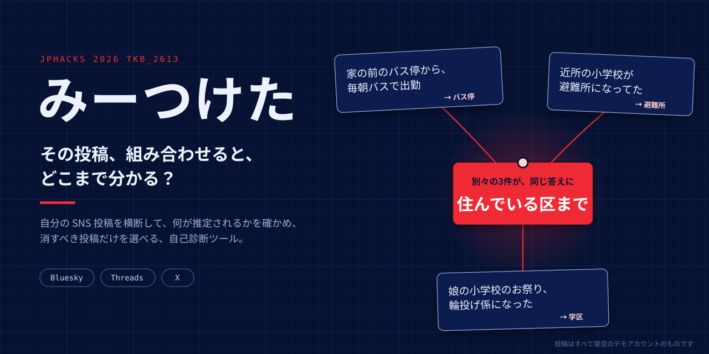
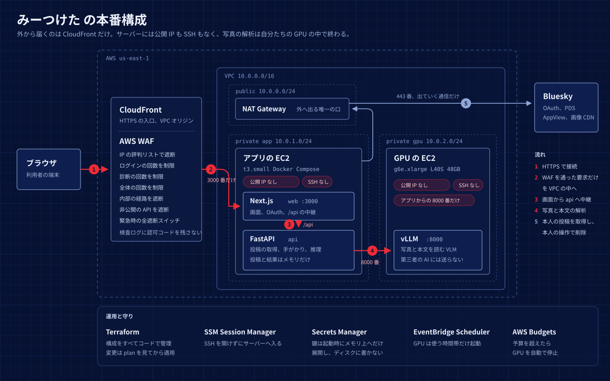

# みーつけた

<!-- TODO: 画像 #4 デモ動画ができたら、見出し画像のリンク先を新しい動画に差し替える（今は Hack Day のデモ動画） -->

**その投稿、組み合わせると、どこまで分かる？**

<!-- TODO: スライドのバッジ（発表資料の URL が決まったら足す） -->

 
スマホでどうぞ（ログインなしの体験デモ）

**住所は書いていない。それでも、何気ない投稿を重ねると、住んでいる区まで絞れてしまう。**

みーつけたは、自分の SNS 投稿をまとめて読み、写真と文章の手がかりを国の公開データと照らして、何が推定されるかを確かめる自己診断ツールです。推定の根拠を一つずつたどり、「この投稿がなかったら」を消す前に試して、本当に消すべき投稿だけを選べます。

> [!NOTE]
> **対応している SNS**
> - **Bluesky**：本番で公開。OAuth でログインし、診断・仮除外・削除・再診断まで行えます
> - **Threads**：テスター限定の本番（Meta に Threads Tester として登録したアカウントだけ）。本文の診断と仮除外まで（削除はしません）
> - **X**：合成投稿のデモだけ。実アカウントの連携は X の用途承認と費用承認を待っています
>
> 診断は GPU のモデルサーバーが動いている間だけ使えます（止まっているときは「準備中」）。体験デモはいつでも使えます。

## 30秒でわかる みーつけた

<!-- TODO: 画像 #5 30秒でわかる GIF（または画像 #6 の①〜③を横に3枚） -->

| ① 投稿から手がかり | ② 推理の連鎖と根拠 | ③ 消す前に比べる |
| --- | --- | --- |
| 写真と本文から「見えたもの・書いてあるもの」を投稿ごとに抜き出す | 手がかりを公開データと照らし、投稿をまたいで推定する。推定ごとに根拠の投稿へ戻れる | 投稿を仮に外して計算し直し、推定できた項目が N → M にどう減るかを見る。消すのは本人が確認した投稿だけ |

## 目次

- [製品概要](#製品概要)（背景・製品説明・特長・解決出来ること・今後の展望・注力したこと）
- [開発技術](#開発技術)（活用した技術・独自技術・セキュリティとプライバシー）
- [Kaizen Sprint での進化](#kaizen-sprint-での進化hack-day--award-day)
- [実際のデモによる動作確認](#実際のデモによる動作確認)

実モードの環境構築と診断手順は[環境構築の手順](docs/setup.md)、API とイベントの詳細は[現行 API・SSE 契約](docs/api-sse-contract.md)を参照してください。

## 製品概要

### 背景（製品開発のきっかけ、課題等）

みなさん、こんな投稿をしたことはありませんか？

> 「燃えるゴミ出し忘れた。朝はお弁当作りでバタバタ。」  
> 「娘の小学校のあおぞらフェスタ、今年は輪投げ係になった。」  
> 「近所の千駄木小学校が避難所になっているので、防災リュックを見直した。」  
> 「家の前のバス停、千駄木三丁目から毎朝バスに乗って出勤。」

どれも住所を書いていない、何気ない投稿です。でも、ゴミの収集日は地区ごとに決まっていて、避難所やバス停の場所、小学校の通学区域も、国や自治体が誰でも使える形で公開しています。

上の投稿は、私たちが作った架空の保護者のデモアカウント（9件、[`demo_layered.json`](eval/fixtures/demo_layered.json)）のものです。このアカウントを診断すると、避難所・バス停・子どもの学校の学区という別々の道筋が、同じ「文京区」を指しました。さらに、届いた荷物の写真の伝票に住所の一部が写っていると、ゴミの日の投稿と合わせて町丁目（千駄木3～5丁目）まで絞れます（結果は [`test_demo_layered.py`](engine/tests/test_demo_layered.py) で固定しています）。

自分の投稿を1件ずつ覚えていても、どれとどれが結び付くかを自分で確かめるのは簡単ではありません。危ないと分かっても、全部消すわけにもいきません。

そこで私たちは、「投稿の組み合わせから何が分かるか」と「どの投稿を消せば推定が崩れるか」を、本人が確かめられる仕組みを作りました。

<!-- TODO: 画像 #8 背景の投稿の画像（架空の人物の投稿が並んだ画面） -->

### 製品説明（具体的な製品の説明）

利用者が自分の Bluesky アカウントにログインすると、本人の直近の投稿（最大30件）を取得し、写真と本文から手がかりを抽出します。推理エンジンは、手がかりを公開データや知識表と照合し、投稿をまたいで組み合わせます。

1. **ログイン**：Bluesky の OAuth で許可する。アプリにパスワードは入力しない
2. **診断**：投稿ごとに手がかりが抽出される様子が、順に画面に流れる
3. **根拠**：推定された項目を押すと、根拠の投稿と手がかりに戻れる。確からしさが弱い推定には印が付く
4. **仮除外**：「消したらどうなる？」で、提案された投稿を消さずに外した場合を試算する
5. **削除**：選んだ投稿を、確認ダイアログで確定したときだけ Bluesky から削除する
6. **再診断**：残った投稿で診断し直す

診断の結果が出たあとは、これから投稿する下書き（本文と写真）が、過去の投稿の手がかりと重ならないかも確かめられます。

<!-- TODO: 画像 #4 または #6 ログイン → 診断 → 根拠 → 仮除外 → 削除 → 再診断 の画面 -->

### 特長

#### 1. 1件では分からないことを、投稿の組み合わせから示す

写真と本文を1件ずつ独立に判定するのではなく、投稿をまたいで手がかりを照合します。推理ルール（R1〜R12 と、別々の投稿をつなぐ X1〜X5）と、投稿を横断したプロフィール推定（居住地域・よく使う駅・勤務先・子どもの年齢・子どもの学校）を実装しています。

#### 2. 国の公開データで「X は Y」を引く。ただし本人のことは外で調べない

避難所・バス停・学区・法人番号などの公開データを、事前に取得した手元の表として持ち、「投稿で見えた X は Y にある」という一般的な知識としてだけ使います。投稿や推定した名前を、データの提供元や外部へ問い合わせることはしません。根拠には出典を出します（[推定に使う範囲](#推定に使う範囲)）。

#### 3. 推定から根拠の投稿へ戻れる。弱い推定には印

「何が見えたか・何が書かれていたか」という観測と、そこから導いた推理を分けています。推定ごとに「推理の流れをたどる」を開くと、「根拠の投稿 → その投稿から取った手がかり → 推定」の順に並びます。根拠の手がかりの確からしさを 1 − ∏(1 − c) で合成し、0.8 未満の推定にだけ「確からしさ：弱い」の印を付けます。

<!-- TODO: 画像 #6-② 結論と推理の連鎖 -->

#### 4. 消す前に効果を比べ、消すべき投稿だけを選べる

削除候補を仮に取り除き、残った手がかりで推理し直します。推定できた項目の数を「N → M」で大きく見せ、どの投稿を見直すと推定が成り立たなくなるかを確かめられます。候補は最大3投稿まで提示します。実削除は本人の確認後に限り、モデルが自動で投稿を削除することはありません。

<!-- TODO: 画像 #6-③ 仮除外の N → M、画像 #6-④ 削除の確認ダイアログ -->

### 解決出来ること

* **自分の投稿履歴から、何が推定されうるかを確認できます。** 個々の投稿では気づきにくい情報のつながりを可視化します。
* **推定につながった投稿を把握し、具体的な対策を選べます。** 結論と根拠の対応、投稿を仮に除いた場合の変化を見て、必要な記録をできるだけ残しながら、どの投稿を見直すかを判断できます。
* **今後の情報発信を考える材料になります。** どの手がかりが結び付いたかを見ることで、次に写真を載せるときに何を隠すか、文章をどこまで具体的に書くかを、自分で考えるきっかけを作ります。

### 今後の展望

* **公開データを全国へ広げる。** 今の収集地区は文京区のオープンデータだけで、多摩地域の指定ごみ袋などは手作りの表です。自治体の公開データを増やし、推定できる地域を広げます。
* **Threads と X を一般に開く。** Threads は Meta の App Review、X は用途承認と費用承認が済めば、テスター以外にも開けます。X は承認後も、実投稿は本人に原文を表示するだけにします。
* **悪用されうるシナリオを示す。** 生活圏や定期的な外出の情報が、待ち伏せや不在時間を狙った被害につながりうることを、自分の診断結果と結び付けて示し、対策の必要性を「自分ごと」として感じられるようにします。

### 注力したこと（こだわり等）

* **AI に任せる部分と、ルールで決める部分を分けた。** AI は「投稿に何が写っていて、何が書かれているか」を読み取るところまで。推定と削除候補の選定は、確かめられるルールで行います（[下の表](#aiに任せる部分とルールで制御する部分)）。同じ日にまとめて投稿された履歴では時刻を使う推理を抑え、バーコードはモデルではなく画像処理で読みます。
* **第三者の AI に送らない。** 写真・本文のモデル解析にはチーム管理下のサーバーだけを使い、許可リストにない送り先は拒否します（[`guard.py`](detect/src/tkb_detect/guard.py)）。投稿と手がかりは API のセッションメモリに一時保持し、ログアウト・期限切れ・次の診断開始時に破棄します。
* **作らないものを先に決めた。** ハンドル名や URL からの診断、他人のアカウントの診断、まとめてのクロール、顔から人物を当てる機能、本人の操作なしでの結果共有、モデルによる自動削除、名前や URL を手で入れて Web を検索する機能は作りません（[`CLAUDE.md`](CLAUDE.md) の「作らないもの」）。「本人が、自分の投稿について、消す前に確かめる」ための道具にとどめ、他人を調べる道具にならないようにしています。
* **方針を途中で変えた。** Hack Day 前は「投稿前の写真1枚を塗って隠す」案でした。1日目（2026-10-24）の13時に、写真と文章を含む投稿履歴全体を振り返る今の形に変えました。

## 開発技術

### 活用した技術

#### API・データ

* Bluesky（AT Protocol）：公式 SDK `@atproto/oauth-client-node` による OAuth ログイン、本人投稿の取得、本人が確認した投稿の削除
* Threads API：`threads_basic` の OAuth と本人投稿の本文の取得（テスター限定）
* X API：OAuth 2.0 PKCE と本人投稿の取得を実装（用途承認・費用承認まで無効）
* FastAPI・Server-Sent Events：投稿、手がかり、推定結果、削除候補の逐次配信
* チーム管理下の vLLM サーバー：写真と本文からの手がかり抽出。PP-OCRv5：文字認識
* zxing-cpp・独自デコーダ：一般的なバーコードと日本郵便のカスタマバーコードの読み取り
* Ollama・Qwen3 4B（検証用）：本文だけを CPU で処理する経路
* AWS：CloudFront、WAF、非公開サブネットの EC2（アプリ・GPU）、Secrets Manager、AWS Budgets。Terraform で管理

#### 推定に使う範囲

推定に使うのは、ログインした本人の投稿とプロフィール文だけです。公的な公開データは、本人について調べるためではなく、「投稿で見えた X は Y にある」という**一般的な知識**としてだけ使います。

* **事前に取得した手元の表だけを使う。** 公開データは `make data` で取得・変換して `data/processed/` に置き、診断のたびに外部へ問い合わせることはしません。
* **本人との関係は投稿に明示されたものだけ。** 「自宅近くの X」「家の前のバス停、X」「X で働いてる」のように本人との関係が書かれた投稿と、同じ X が出てくる別の投稿がそろったときだけつなぎます。写っているだけ・訪れただけの施設からは推定しません。同じ名前が2つ以上の場所にあるときも推定しません。
* **根拠に出典を出す。** 公開データを使った推定は、画面の根拠に出典と注意書き（データの時点など）を出します。
* **公開 Web 検索は本番では使わない。** 本人が診断ごとに同意した場合だけ、本人の公開ハンドルで検索する経路を実装していますが、本番では検索の鍵を設定しておらず使えません。

| 公開データ（提供元） | つなぐ推定 | データの時点 |
| --- | --- | --- |
| 指定緊急避難場所・指定避難所データ（国土地理院） | 居住地域（「自宅近くの X」の X が避難所） | 随時更新（2026-11-12 取得） |
| 国土数値情報 バス停留所データ P11（国土交通省） | 居住地域（「家の前のバス停、X」）。事業者名か区市町村名で1つに絞れたときだけ | 令和4年度 |
| 国土数値情報 小学校区 A27・中学校区 A32（国土交通省） | 子どもの学校 → 居住地域。「再配布・再利用不可」の自治体は取り込まない | 令和3年度 |
| 国土数値情報 行政区域データ N03（国土交通省） | バス停・学区がどの区市町村にあるかの判定 | 2026年1月1日 |
| 法人番号公表サイトの全件データ（国税庁） | 勤務先名（本人が書いた名前 → 正式名称。一意に決まるときだけ） | 2026年10月30日 |
| 国土数値情報 駅別乗降客数データ S12（国土交通省） | 最寄り駅の候補が複数残ったときの参考表示だけ | 2024年度 |
| ごみと資源の収集日（文京区） | ゴミの日の推理（収集地区） | 2026-03-23 更新のファイル |

そのほかの公開データと、手作りの知識表の範囲

駅（鉄道データ N02）、郵便番号、市区町村別メッシュ、世帯数、学校コード、市外局番も公開データです。取得元・利用条件・出典の書き方は [`data-prep/SOURCES.md`](data-prep/SOURCES.md)、変換した表の列は [`data-prep/README.md`](data-prep/README.md) にあります。

手作りの表（[`data-prep/manual/knowledge.json`](data-prep/manual/knowledge.json)）は、行ごとに出典と未確認の点を記録しています。

| 範囲 | 状態 |
| --- | --- |
| 文京区の収集地区（33地区） | 文京区のオープンデータから変換（`python -m tkb_data_prep.bunkyo_collection`） |
| 多摩地域の市の指定ごみ袋の値段（25市） | 手作り（西東京市の審議会資料からの転記。袋の色は未確認） |
| 八王子市の収集地区 | 手作り（市の町名一覧からの転記。燃やすごみの曜日は未記入） |
| 大学の時限・最寄り駅（2大学） | 手作り（各大学の案内からの転記。時限の時刻は一部未確認） |

#### フレームワーク・ライブラリ・モジュール

* Web：Next.js App Router、React、TypeScript、Tailwind CSS
* API・共通型：Python、FastAPI、Pydantic
* 画像処理：Pillow、NumPy、SciPy、zxing-cpp
* 推理・候補選定：ルールベースの推理、貪欲法による最大3投稿の候補選定
* 検証：pytest、Vitest、Playwright、ruff、mypy、ESLint、TypeScript 型検査、GitHub Actions
* インフラ：Terraform、Docker Compose

#### デバイス

Web ブラウザが動く PC・スマートフォン。実投稿の診断には、Bluesky（または Threads のテスター）のアカウントと、チーム管理下のモデルサーバーが必要です。

### 独自技術

#### ハッカソンで開発した独自機能・技術

* **投稿横断の推理エンジン**：写真と本文から得た観測を、地域情報や別投稿の手がかりと組み合わせて推定します（[`rules.py`](engine/src/tkb_engine/rules.py)）。
* **投稿を仮に外した再計算と削除候補の選定**：投稿を除いた場合に推定がどう変わるかを、モデルを呼ばずに再計算します。17項目の推定（`ATTRIBUTE_WEIGHTS`）と、写真や文字に直接写った顔・名前・住所・電話番号・郵便番号（`DIRECT_CLUE_WEIGHTS`）に重みを付け、残る危険の合計が最も減る投稿から順に最大3投稿を選びます（貪欲法）。全項目に対して最小の削除件数を保証する方式ではありません（[`planner.py`](engine/src/tkb_engine/planner.py)）。
* **観測から結果表示までの逐次配信**：本人投稿の取得、手がかり抽出、推理、候補提示をつなぎ、SSE で画面へ配信します（[`pipeline.py`](api/src/tkb_api/pipeline.py)、[`DiagnosePanel.tsx`](web/src/components/diagnose/DiagnosePanel.tsx)）。
* **本人の確認を伴う実削除**：選んだ投稿だけを、確認ダイアログで確定したときに本人の Bluesky アカウントから削除します。

Hack Day 前に用意した土台（開発環境、共通の手がかり形式、モック API と画面の骨組み、OCR/VLM クライアントと安全ガード、公開データ変換）と、Hack Day 中の実装の区別は[事前開発の記録](docs/pre-hackday.md)にあります。

#### AIに任せる部分と、ルールで制御する部分

| 段階 | 担当 | 内容 |
| --- | --- | --- |
| 観測（手がかりの抽出） | AI（VLM／検証用に Qwen3 4B）＋OCR・バーコード読み取り | 駅名標、店名、ごみ袋、本文の地名などを「見えたもの・書いてあるもの」として抜き出す。推理は含めない |
| 検証 | ルール | 決めた形式どおりの手がかりだけを受け付ける。CPU 経路（Qwen3 4B）では、引用が投稿本文に実在するかも照合し、合わない手がかりだけを捨てる |
| 推論（投稿の横断） | ルール（R1〜R12・プロフィール推定）＋公開データ・知識表 | 複数の手がかりを組み合わせて推定する。結論ごとに根拠の投稿と手がかりを保持し、確からしさを 1 − ∏(1 − c) で合成する |
| 仮に外した再計算・削除候補 | ルール（モデルを呼ばない再計算） | 投稿を除いた手がかりで同じルールを再実行し、推定がどう変わるかを示す |
| 実削除 | 本人 | 画面で選び、確認ダイアログで確定した投稿だけ。モデルには削除の権限も道具も渡さない |

### セキュリティ・プライバシーへの配慮

| 観点 | 設計 |
| --- | --- |
| 診断の対象 | ログインした本人のアカウントだけ。ハンドル名や URL を入力して他人を診断する欄・API は作っていません |
| ログイン | Bluesky OAuth。アプリはパスワードを受け取りません。要求する権限は本人確認と投稿の削除だけです |
| 削除 | 本人が選び、確認ダイアログで確定した投稿だけ。API は本人の投稿で、かつ直前に診断した投稿であることを確かめます。削除・ログアウト・閲覧リンクの操作は、自サイトの `Origin` からの要求だけを受け付けます |
| セッション | サーバーのメモリに保持し、期限（`SESSION_TTL_MINUTES`、既定30分）かログアウトで失効します。ブラウザにはトークンを渡しません。OAuth のトークンは、ログアウト時と期限切れ時に Bluesky 側でも失効させます |
| 投稿と推論結果 | API のセッションメモリに一時保持し、保存しません。リクエスト本文はログに出しません。閲覧リンクの機能は本番では無効です（`SHARE_ENABLED=0`） |
| モデルの送信先 | 許可リストに載ったチームのサーバーだけに送り、第三者の AI サービスの推論 API には送りません。画像の取得先も `cdn.bsky.app` に限定しています |
| 投稿内の指示 | 投稿の本文や写真の文字はデータとして扱い、モデルには操作の道具を渡しません |
| AWS | 非公開サブネットの GPU、セキュリティグループと API キーによる制限、WAF のレート制限と内部経路（`/__internal`）の遮断。AWS Budgets で$80に達したら GPU を止めます |

アプリは12カテゴリ（認証境界、セッション、認可、入力検証、情報漏えい、SSRF、プロンプトインジェクションなど）で検査し、AWS 本番にも読み取りだけの追加検査を行いました（[セキュリティ検査報告書](docs/security/REPORT.md)）。確かめた範囲と残っている課題は [Kaizen Sprint の記録](docs/kaizen-sprint.md)の⑥にあります。完全な安全を保証するものではありません。

## Kaizen Sprint での進化（Hack Day → Award Day）

Hack Day 後は、「実際の利用者が安心してログインし、診断から対策まで終えられること」を目標に改善しました。詳細と、まだ確かめていないことは [docs/kaizen-sprint.md](docs/kaizen-sprint.md) にまとめています。

| | Hack Day | Award Day |
| --- | --- | --- |
| ログイン | App Password | Bluesky 公式 SDK の OAuth。パスワードを入力せず、権限は本人確認と投稿の削除だけ。ログアウトでトークンを失効 |
| 結果の見せ方 | 推定と根拠 | 推理の流れをたどる表示、弱い推定の印、削除前後の項目数 N → M、削除した投稿は開き直しても戻らない、下書きの確認 |
| 推定に使う知識 | 駅などの公開データと手作りの知識表 | 避難所・バス停・学区・法人番号の公開データを「X は Y」の知識として追加し、投稿を横断したプロフィール推定に使う |
| 対応 SNS | Bluesky | Bluesky に加え、Threads（テスター限定の本番）と X（合成デモ）。共通の `Post` 型で同じ推理エンジンを使う |
| ログインなしの体験 | なし | 体験デモ（`/demo`）。モデルにも Bluesky にも接続しない |
| 動かす場所 | 手元・共有の GPU | AWS（CloudFront・WAF・非公開サブネットの EC2・Secrets Manager・Budgets）を Terraform で構築し、検査 |

## 実際のデモによる動作確認

Hack Day には、実際の Bluesky アカウントの投稿12件から18個の手がかりが抽出され、最寄り駅、利用路線、年齢、学校、定期的な外出などが推定結果として表示されることを確認しました。

<!-- TODO: 画像 #7 スマホの画像（トップページと /demo の結果）を横に2枚 -->

| 範囲 | 確認の状況 |
| --- | --- |
| Bluesky：OAuth ログイン → 実投稿の診断 → 削除 → 再診断 | AWS 上の本番構成で、実アカウントを使って検証 |
| Bluesky：実投稿の診断と推定結果の表示 | Hack Day に実投稿12件・手がかり18件で確認（上記） |
| 体験デモ（`/demo`） | ログイン不要。自動テストで、`MOCK_MODE=0` でも外部へ通信しないことを確認 |
| Threads：OAuth・本人投稿の取得・診断・仮除外 | 本番の公開設定で実ログインが有効（2026-11-14 に `/api/threads/config` で確認）。経路は API テストとブラウザーテストで確認。テスターの実アカウントで本番を通した記録はまだない |
| X：OAuth・本人投稿の原文表示 | 偽の X API で OAuth からログアウトまでを CI の Playwright で確認。実際の X の投稿は使っていない |
| X：合成投稿のデモ（抽出・件数・仮除外） | 自動テストとブラウザーテストで確認 |
| CPU（Qwen3 4B）による本文の診断 | 検証用。架空投稿12件での評価（[手順と評価](docs/local-ollama-text.md)） |

当日の操作手順と、止まったときの対処は[当日の手順書](docs/day-of-runbook.md)にあります。

## チーム

<!-- TODO: メンバーと担当、GitHub のアイコン -->

JPHACKS 2026 東京B会場 tkb_2613。コミットした人は [Contributors](https://github.com/jphacks/tkb_2613/graphs/contributors) から見られます。
