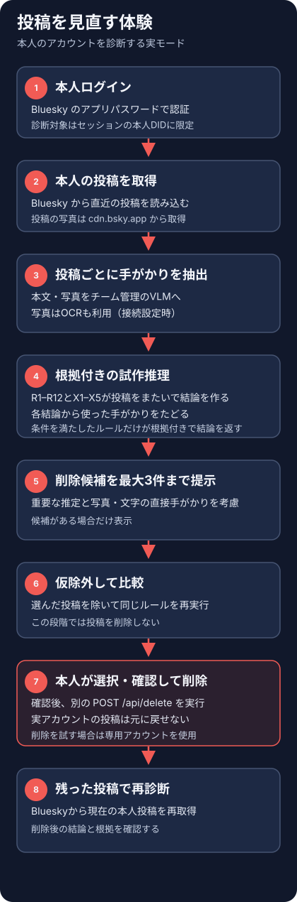
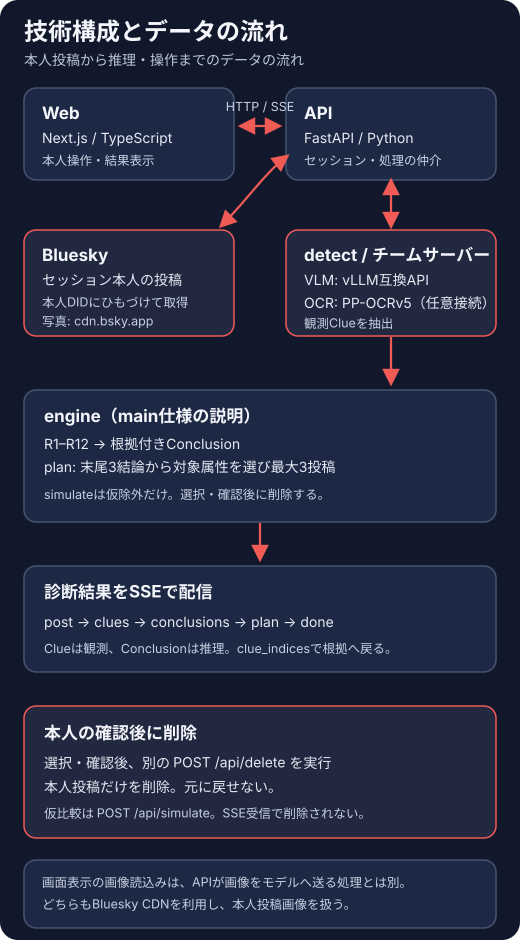
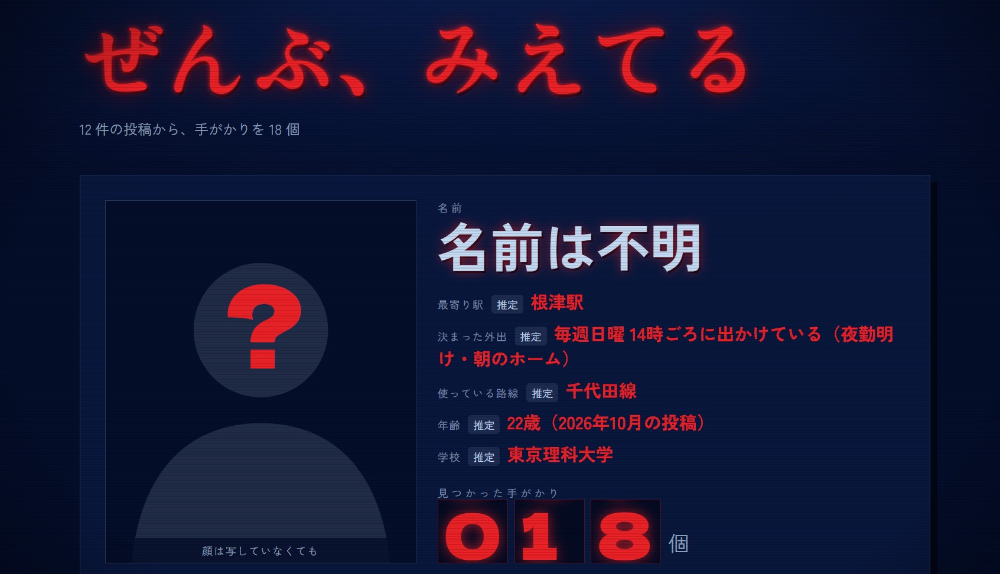

# みーつけた

[](https://www.youtube.com/watch?v=piaNsc6ilBI)

**その投稿、組み合わせると、どこまで分かる？**

「みーつけた」は、Blueskyの自分の投稿を横断し、写真や文章の手がかりから、どのような生活情報が推定されうるかを確かめるWebアプリです。

推定結果と根拠を確認し、投稿を仮に取り除いた場合の変化を比較できます。その結果を見て、本人が投稿を削除するかを判断できます。

> **何気ないSNS投稿を組み合わせると、どこまで個人情報が推測されるのか。その根拠を可視化し、投稿を見直した場合の変化まで体験できる。**

| 1. 問題提起 | 2. 診断 | 3. 根拠の可視化 | 4. 仮に外して比べる | 5. 対策 |
| --- | --- | --- | --- | --- |
| 1件ずつは無害な投稿でも、組み合わせると生活が見える | 本人の投稿を横断して、写真と本文から推定する | 推定ごとに、使われた投稿と手がかりへ戻れる | 「この投稿がなかったら」を消さずに試算する | 本人が確認した投稿だけを削除し、再診断する |

**Award Day版のポイント**（詳細は[Kaizen Sprintでの進化](#kaizen-sprintでの進化hack-day--award-day)）

* Blueskyの公式AT Protocol OAuth SDKでログイン。パスワードをアプリに入力せずに診断から削除・再診断まで行えるようにし、AWS上で検証しました。
* 共通の投稿データ構造の上で、ThreadsとXへの拡張をPoCとして検証しています（本番公開はBlueskyのみ）。
* 画像を読むGPUのモデルに加え、本文だけをCPUで処理する軽量な経路（Qwen3 4B）も検証しました。
* ログインせずに架空のアカウントで診断と「消したらどうなる？」を試せる体験デモ（`/demo`）を追加しました。体験デモはモデルにもBlueskyにも接続しません。

実モードの環境構築と診断手順は[環境構築の手順](docs/setup.md)、APIとイベントの詳細は[現行 API・SSE 契約](docs/api-sse-contract.md)を参照してください。

## 製品概要

### 背景（製品開発のきっかけ、課題等）

住所や本名を直接投稿していなくても、写真に写った駅名や店名、何気なく書いた生活上の出来事が、別の投稿と結び付くことで個人情報の手がかりになることがあります。

自分の投稿を一件ずつ覚えていても、過去の履歴をまとめて読み、どの情報がどう結び付くかを確認するのは簡単ではありません。また、危険だと分かっても、どの投稿を見直せばよいか判断できなければ、具体的な対策にはつながりません。

そこで、「投稿の組み合わせから何が分かるか」と「どの投稿を見直すと推定が崩れるか」を、本人が確かめられる仕組みを作りました。

Hack Day前は「投稿前の写真1枚を塗って隠す」案でしたが、1日目に、写真と文章を含む投稿履歴全体を振り返る現在の形へ転換しました。

### 製品説明（具体的な製品の説明）

利用者が自分のBlueskyアカウントにログインすると、本人の投稿を取得し、写真と本文から手がかりを抽出します。推理エンジンは、手がかりを公開データや知識表と照合し、投稿をまたいで組み合わせます。

現在はR1〜R12のルールを実装し、居住エリア、利用駅・路線、通学先、名前、年齢・生年月日、仕事や生活パターンなどに関する推定を行います。結果には根拠となる手がかりを結び付け、元の投稿を確認できるようにしています。

削除候補を選ぶと、実際に消す前に、その投稿を仮に除いた結果を確認できます。Blueskyからの削除は、本人が投稿を選び、確認ダイアログで確定した場合だけ実行します。削除後は、残った投稿で診断し直せます。

### 特長

#### 1. 一件では分からないことを、投稿の組み合わせから示す

写真と本文を一件ずつ独立に判定するのではなく、投稿をまたいで手がかりを照合します。

例えば、指定ごみ袋の容量・価格から得られる地域の候補と、別の投稿にある距離の情報を組み合わせて候補を絞ります。単独では断片的な情報が、どのように結論につながるかを示します。

#### 2. 推定結果から、根拠の投稿へ戻れる

「何が見えたか・何が書かれていたか」という観測と、そこから導いた推理を分けています。

結論には根拠の手がかりを保持するため、利用者は推定の理由を確認できます。実情と異なる推定が出た場合も、読み取りの誤りや推論の飛躍を確かめる材料になります。

#### 3. 消す前に、対策の効果を比較できる

削除候補を仮に取り除き、残った手がかりで推理し直します。履歴全体を消すのではなく、どの投稿を見直すと対象の推定が成立しなくなるかを確認できます。

候補は最大3投稿まで提示します。実削除は本人の確認後に限り、モデルが自動で投稿を削除することはありません。

以下は、診断体験の流れを示す説明図です。画面キャプチャではなく、構成を説明するSVG図です。



### 解決出来ること

**自分の投稿履歴から、どのような情報が推定されうるかを確認できます。**

日常の写真や何気ない文章をまとめて振り返り、個々の投稿では気づきにくい情報のつながりを可視化します。

**推定につながった投稿を把握し、具体的な対策を選べます。**

結論と根拠の対応、投稿を仮に除いた場合の変化を確認し、必要な記録をできるだけ残しながら、どの投稿を見直すかを判断できます。

**今後の情報発信を考える材料になります。**

実際にどの手がかりが結び付いたかを見ることで、次に写真を載せるときに何を隠すか、文章のどこまでを具体的に書くかを、自分で考えるきっかけを作ります。

### 今後の展望

今回目指した「投稿を横断して推定し、根拠を確認し、対策前後を比較する」という一連の体験を実装できました。今後は実際の利用を通じて、推定の妥当性と操作の分かりやすさを磨いていきます。また、Blueskyに加え、XやInstagramなど主要SNSへの対応も検討しています。より多くの人が、普段使っているSNSの投稿から個人情報の露出に気づき、対策を選べるサービスへ広げていきます。

さらに、推定された個人情報が現実世界でどのように悪用されうるか、具体的なシナリオを提示する機能を検討しています。例えば、生活圏や定期的な外出の情報が、待ち伏せや不在時間を狙った被害につながる可能性を、自分の診断結果と結び付けて示します。ユーザーが情報の露出を「自分ごと」として捉え、対策の必要性を強く感じられる体験を目指します。

Award Dayまでに、ThreadsとXについては本人の投稿を共通形式に変換して診断する経路をPoCとして試しました（[Kaizen Sprintでの進化](#kaizen-sprintでの進化hack-day--award-day)）。一般公開には、各社のOAuth審査・API規約上の用途確認・運用試験が残っています。

### 注力したこと（こだわり等）

* **組み合わせの過程を説明できること。** 手がかりの抽出と推理を分離し、結論は明示的なルールで組み立てます。結果だけでなく、どの投稿のどの情報が使われたかを確認できるようにしました。

* **対策の前後を同じ条件で比較できること。** 投稿を仮に外して比べるときは、抽出済みの手がかりから対象投稿の分を取り除き、同じルールを再実行します。候補選定と再計算には言語モデルを使いません。

* **投稿の事情に合わない推定を抑えること。** 同じ日にまとめて投稿された履歴では、投稿時刻が生活のリズムを表すとは限らないため、時刻を使う推理を抑制します。バーコードも画像処理で読み取り、モデルが推測した中身を住所の区画の根拠にしないようにしています。

* **本人が情報の扱いを決められること。** 診断対象はログインした本人の投稿に限定します。削除は本人の選択・確認後にだけ実行し、モデルには操作権限を渡しません。

* **解析するデータの扱いを限定すること。** 写真・本文のモデル解析にはチーム管理下のサーバーを使い、第三者のAIサービスの推論APIには送りません。投稿と手がかりはAPIのセッションメモリに一時保持し、ログアウト・期限切れ・次の診断開始時に破棄します。

## Kaizen Sprintでの進化（Hack Day → Award Day）

Hack Day後は、「実際の利用者が安心してログインし、診断から対策まで終えられること」を目標に改善しました。ここでは、実機で確かめたこととPoC（試作）段階のことを分けて書いています。

### ① Bluesky OAuth対応

Hack Day版はApp Passwordでのログインでしたが、Blueskyの公式AT Protocol OAuth SDK（[`@atproto/oauth-client-node`](web/src/lib/server/oauth.ts)）によるログインを追加しました（PR #126〜#130）。

* **パスワードをアプリに入力しない。** 利用者はBluesky側の画面で許可するだけです。`AUTH_MODE=oauth`では、パスワード入力欄とパスワード用APIを無効にします。
* **権限を絞る。** 要求するスコープは本人確認と投稿の削除（`atproto repo:app.bsky.feed.post?action=delete`）だけです。投稿の作成や編集の権限は求めません。PKCE・PAR・DPoP・トークン更新はSDKに任せています。
* **トークンをブラウザに渡さない。** OAuthのトークンはNext.jsサーバーのメモリに置きます。ブラウザに渡すのは、ランダムなセッションCookieと、認可の開始を結び付ける短命のCookieだけです。セッションは30分かログアウトで失効し、同じアカウントで再ログインすると古いセッションは無効になります。
* **AWS環境での認証。** CloudFront・WAF経由で認可のコールバックを受け、WebとAPIの間は起動ごとに作る内部共有秘密で認証します（[`infra/terraform/`](infra/terraform/README.md)）。AWS上での試験で見つかった、Cookieが消える不具合（#128）、OAuthセッションで診断を開始できない不具合（#129）、内部の削除経路がビルドされない不具合（#130）を修正しました。

### ② 対策まで行える診断体験

Blueskyでは、次の一連の流れを実アカウントで動かしています。

```text
本人の投稿を取得 → 画像・本文から手がかりを抽出 → 投稿を横断して推論 → 根拠を表示
  → 投稿を仮に外して再計算 → 本人が確認した投稿だけを実削除 → 残った投稿で再診断
```

削除は、利用者が投稿を選び、確認ダイアログで確定した場合だけ実行します。APIは、削除対象が本人のアカウントの投稿で、かつ直前に診断した投稿であることを確かめてから削除します。

結果の画面では、次のように推定の理由と対策の効果を確かめられます（#152〜#154・#160）。

* **推理の流れをたどる。** 捜査ボードの推定ごとに「推理の流れをたどる」を開くと、「根拠の投稿 → その投稿から取った手がかり → 推定とメモ」の順に並びます。使うのは本人の投稿と手がかりだけで、外のWebは見ません。
* **確からしさが弱い推定に印を付ける。** 推定ごとに、根拠の手がかりの確からしさを 1 − ∏(1 − c) で合成します。画面に数字は出さず、0.8未満の推定にだけ「確からしさ：弱い」の印を付けます。
* **削除前後の項目数を見せる。** 「消したらどうなる？」の試算や削除の結果に、推定できた項目の数を「N → M」と大きく表示します。同じ項目に推定が2つあっても1と数えます。
* **削除した投稿は、開き直しても候補に戻らない。** 削除できた投稿はセッションに記録し、画面を開き直したときの推定・削除候補・「消したらどうなる？」の計算から除きます（#147・#149）。

**ログインなしの体験デモ（`/demo`、#156）。** トップの「ログインせずに、架空のアカウントで試す」から開けます。リポジトリにある架空アカウントの投稿と手がかり（[`demo_observations.json`](eval/fixtures/demo_observations.json)）を同じ推理にかけ、推定・根拠と、削除候補を「消したらどうなる？」で試せます。モデル・Bluesky・セッションには接続せず、削除の操作もありません。画面の一番上に「架空のアカウントです」と常に表示します。

> Blueskyから投稿を削除しても、第三者が保存したスクリーンショット、引用、すでに他のサービスに複製されたデータまで消えるわけではありません。「みーつけた」が示すのは、今後この投稿から推定される範囲を減らせるかどうかです。

### ③ 複数SNSへの拡張

診断の中心（手がかりの抽出・推論・仮除外）は、共通の投稿データ構造（[`Post`](common/src/tkb_common/schemas.py)）を入力にしています。そのため、SNSごとに「認証して本人の投稿を取得し、`Post`に変換する部分」を用意すれば、同じ推論エンジンを使えます。

| | Bluesky | Threads | X |
| --- | --- | --- | --- |
| 位置付け | 本番（Award Dayの実演対象） | PoC | PoC |
| 認証 | 公式SDKのOAuth | テスター本人のアクセストークン（一般ユーザー向けOAuthは未実装） | OAuth 2.0 PKCEを実装（実Xアカウントでの運用は未実施） |
| 投稿の取得 | 本人の投稿（写真・本文） | 本人の投稿の本文（最大30件） | 本人の投稿の本文を取得する経路を実装 |
| 診断 | 実投稿で診断・仮に外した再計算・再診断 | 本人テスト投稿3件をAWS GPUで診断 | 合成データ（架空投稿）で診断・仮除外・再診断を検証 |
| 削除 | 本人の確認後に実削除・再診断 | なし（仮除外のみ） | なし（仮除外のみ） |
| 公開までの課題 | — | 一般ユーザー向けOAuth、画面、運用試験 | API規約上の用途確認、API費用の承認 |

Xについては、実際の投稿を使った個人情報の推定は行っていません。Xの開発者規約は個人のプロファイリングや非公開情報の導出を制限しているため、本人が同意する自己診断でも許されるかを、Xに確認してから進めます。詳細は[Threads PoC](docs/threads-poc.md)と[X連携の実装と運用条件](docs/x-poc.md)にまとめています。

### ④ CPU/GPUの2方式での検証

| 経路 | 対象 | モデル・実行環境 | 位置付け |
| --- | --- | --- | --- |
| GPU | 画像を含む投稿・本文 | 既存のVLM（AWSの非公開GPUサーバー上のvLLM） | 本番の既定 |
| CPU | 本文だけ | Qwen3 4B（`qwen3:4b-instruct`）をOllamaで実行 | 検証用（既定には未採用） |

CPUだけの環境でも、本文から手がかりを抽出し、既存の推論エンジンにつなげられることを確認しました（[`ollama_client.py`](detect/src/tkb_detect/ollama_client.py)、[手順と評価](docs/local-ollama-text.md)）。GPUを常に動かさずに済むため、軽量化と運用コスト削減の可能性があります。

一方、架空の投稿12件で比べると、Qwen3 4Bは正解13件のうち9件を抽出し、余計な抽出も6件ありました。本番の既定にするには、精度の改善と本人投稿での評価が必要です。なお、この経路ではモデルが返した引用が投稿本文に実際に含まれるかを確かめ、含まれない手がかりは捨てています。

### ⑤ AWS GPUでの実測

AWSのGPU（g6e.2xlarge、vLLM）で診断を実行し、処理時間を測りました。

| 対象 | 処理時間 |
| --- | ---: |
| Threads本人テスト投稿3件 | 約3.5秒 |
| Threads架空投稿3件 | 約4.9秒 |
| X架空投稿2件 | 約3.3秒 |

参考として、CPU版（Qwen3 4B）でThreads本人投稿3件を再実行したときは約16.5秒、推論プロセスの観測メモリは約3GiBでした。

これらは投稿の内容・件数・測定条件が異なる、それぞれ1回の測定です。GPUとCPUの厳密な性能比較や、精度の優劣を示すものではありません。

### ⑥ AWSへの本番移行とセキュリティ検証

**なぜ移行したか。** 開発・検証は手元のPCや共有のGPUでも動かせますが、本人の投稿と写真を扱うサービスを一般の人に使ってもらうには、「誰が・どこから・何に届くか」を設計で決めておく必要があります。そこで、公開の入口、アプリ、モデルサーバー、秘密の値、費用の上限までAWS上に作り直し、そのうえで検査しました。

**構成と役割**（詳細は[`infra/terraform/`](infra/terraform/README.md)、[移行設計](docs/aws-migration.md)）

| 部品 | 役割（防ぎたいリスク） |
| --- | --- |
| CloudFront | HTTPSの唯一の入口。アプリのサーバーをインターネットに直接さらさない |
| WAF | ログイン・診断・全体のレート制限、Next.jsの内部経路（`/__internal`）の遮断など。大量アクセスや総当たり、内部経路への直接の要求を入口で抑える |
| EC2（アプリ） | パブリックIPなし。CloudFront経由の通信だけを受ける |
| EC2（GPU） | パブリックIPなし。アプリのセキュリティグループからの通信だけを受け、キーのない要求は拒否する。写真と本文が外部へ出ない |
| Secrets Manager | モデルサーバーのAPIキーを`.env`・Terraformの状態・ログに置かない |
| SSM | SSHを開けずに管理する。22番ポートの受け入れ規則は作っていない |
| AWS Budgets | 月$100の予算。$10ごとにメール通知し、$80でGPUを自動停止する |

* **Infrastructure as Code。** ネットワーク、セキュリティグループ、WAF、IAM、予算、スケジュールをTerraformで定義しています。手作業の設定漏れを減らし、変更を差分（plan）で見てから反映できます。
* **AI推論サーバーの保護。** モデルサーバーはプライベートサブネットに置き、外向きの通信は443に絞っています。EC2はIMDSv2必須・hop limit 1にして、アプリのコンテナが乗っ取られてもインスタンスの認証情報に届かないようにしました。キーはホストの起動スクリプトが読み、メモリ上のファイルでコンテナに渡します。
* **GPUの費用管理。** GPUは常時動かさず、公開日の時間帯に合わせて起動・停止します。2026-11-10に、公開時間でアプリが診断を断らない方針にしたため、**GPUを手で起動している間は誰でも診断できます**。止まっているときは「準備中」になります。
* **12カテゴリの検査（アプリ）。** 認証境界、セッション、認可、入力検証、SSRF、プロンプトインジェクションなどを、ローカルの実インスタンスで検査しました（2026-11-06、[総合報告書](docs/security/REPORT.md)）。致命的な欠陥は見つからず、許可リスト方式への変更と投稿URI検証の強化を行いました。
* **AWS本番への追加検査（2026-11-10）。** 公開URLへの読み取りだけの検査（[カテゴリ13](docs/security/13-prod-interim-2026-11-10.md)）と、AWS構成の読み取り専用の実測（[カテゴリ14](docs/security/14-prod-aws-2026-11-10.md)）を行いました。アプリ・GPUに公開IPがないこと、インバウンドが想定のセキュリティグループ参照だけであること、コンテナからインスタンスの認証情報を取れないこと、web・apiがrootで動いていないことを確かめました。

**実際に見つかった問題と対応**

| 問題 | 対応 | 状況 |
| --- | --- | --- |
| 画面にCSPがなく、`x-powered-by`でフレームワークが分かる（中・情報） | `frame-ancestors`・`object-src`・`base-uri`を制限するCSPを付け、`x-powered-by`を消した（#139） | mainにマージ済み。AWS本番にも反映済み（再検査は未実施） |
| 診断前の確認がOCRを見ておらず、OCRだけ停止していると診断が失敗し、1日3回の枠を消費する | 事前確認にOCRの応答を追加（#138） | mainにマージ済み。AWS本番にも反映済み（再検査は未実施） |
| 検査記録の整理 | 13・14の報告を公開用に伏せ字で追加（#137） | mainにマージ済み |

マージとAWS本番への反映は別の作業です（反映にはアプリのEC2でイメージを作り直します）。#138・#139は反映済みですが、反映後に再検査して修正を確認する作業は、まだ行っていません。

**Award Dayに向けて追加した防御**（検査の指摘ではなく、コードの見直しで足したもの）

| 内容 | 実装 | 状況 |
| --- | --- | --- |
| ログアウト時に、Bluesky側でOAuthトークンを失効させる。セッションの期限（既定30分）が来たときも同じ処理を通す。失効に失敗しても、サーバーのメモリからは必ず消す | 公式SDKの`revoke`を呼ぶ（[`oauth.ts`](web/src/lib/server/oauth.ts)、#151） | mainにマージ済み。自動テストで確認 |
| 削除・ログアウト・閲覧リンクの作成と取り消しは、`Origin`が自サイト（`CORS_ORIGINS`）の要求だけを受け付け、ほかは403にする。Cookieの`SameSite=Lax`に加えた確認 | 共通の依存関数（[`origin.py`](api/src/tkb_api/origin.py)、#157）。X・Threadsの確認も同じ関数にそろえた | mainにマージ済み。自動テストで確認 |
| Next.jsの内部経路`/__internal`を、WAFで遮断する。これまでは、CloudFrontの既定の設定がGET・HEAD・OPTIONSしか通さないために届かなかっただけだった | WAFのルール`block-internal`。URLを2回デコードしてから比べる（[`edge.tf`](infra/terraform/edge.tf)、#158） | mainにマージ済み。`terraform validate`は未実施 |

この3件も、AWS本番への反映と、反映後の確認は別の作業です。

**未検証・残課題**（合格とは扱っていません）

* 13で見つかった、HSTSの`includeSubDomains`なし（低）と、OAuthコールバックが異常時も200を返す点（低）は、対応するPRがありません。
* #139のCSPは`script-src`を縛っていません。Next.jsのインラインスクリプトを使うためで、nonceによる強いCSPは今後の課題です。
* 未実施：GPU稼働時のモデルサーバーとOCRの応答、リクエスト時のログに秘密情報が出ないこと、OAuthのstate・Cookie属性・ログアウト、内部経路が外から叩けないこと、削除の拒否、閲覧リンクの期限と推測のしにくさ。AWS上でこれらを確かめる再試験を予定しています。
* ログアウト時のトークン失効（#151）は自動テストで確かめましたが、実際のBlueskyの認可サーバーで、失効後に同じトークンが使えなくなることはまだ確かめていません。
* ホストでsshdが起動しています。セキュリティグループに22番の規則がないため外部から届きませんが、記録しています。

これらは「確かめた範囲」の記録であり、脆弱性がないことの証明ではありません。

## 開発技術

### 活用した技術

#### API・データ

* Bluesky：本人認証、本人投稿の取得、本人が確認した投稿の削除
* FastAPI・Server-Sent Events：投稿、手がかり、推定結果、削除候補の逐次配信
* チーム管理下のvLLMサーバー：写真と本文からの手がかり抽出
* PP-OCRv5：接続設定した場合の文字認識
* zxing-cpp・独自デコーダ：一般的なバーコードと日本郵便のカスタマバーコードの読み取り
* 公開データ・知識表：駅、郵便番号、市区町村、学校、指定ごみ袋、収集地区などの照合
* Bluesky OAuth（Award Dayで追加）：公式SDK `@atproto/oauth-client-node`によるログインと、本人が確認した投稿の削除
* Ollama・Qwen3 4B（検証用）：本文だけをCPUで処理する経路
* Threads API・X API（PoC）：本人の投稿を共通形式に変換して診断する経路
* AWS：CloudFront、WAF、非公開サブネットのEC2（アプリ・GPU）、Secrets Manager、AWS Budgets。Terraformで管理

公開データの取得・変換は`data-prep/`が担当します。必要なデータは`make data`で準備します。手作業で整備する知識表は、出典や未確認の情報を記録しています。

以下は、Web・API・手がかり抽出・推理エンジンの接続を示す説明図です。稼働画面のキャプチャではありません。



#### フレームワーク・ライブラリ・モジュール

* Web：Next.js App Router、React、TypeScript、Tailwind CSS
* API・共通型：Python、FastAPI、Pydantic
* 画像処理：Pillow、NumPy、SciPy、zxing-cpp
* 推理・候補選定：ルールベースの推理、貪欲法による最大3投稿の候補選定
* 検証：pytest、Vitest、ruff、mypy、ESLint、TypeScript型検査、GitHub Actions
* 認証：`@atproto/oauth-client-node`（Award Dayで追加）
* インフラ：Terraform、Docker Compose（Award Dayで追加）

#### デバイス

Webブラウザが動くPC。実投稿の診断には、Blueskyアカウントとチーム管理下のモデルサーバーが必要です。

### 独自技術

#### ハッカソンで開発した独自機能・技術

* **投稿横断の推理エンジン**  
  写真と本文から得た観測を、地域情報や別投稿の手がかりと組み合わせて推定します。実装は[`engine/src/tkb_engine/rules.py`](engine/src/tkb_engine/rules.py)にあります。

* **投稿を仮に外した再計算と削除候補の選定**  
  投稿を除いた場合に推定がどう変わるかを、モデルを呼ばずに再計算します。氏名・生年月日・住まいなど17項目の推定に重みを付け（`ATTRIBUTE_WEIGHTS`）、写真や文字に直接写った顔・名前・住所・電話番号・郵便番号にも重みを付けて（`DIRECT_CLUE_WEIGHTS`）、残る危険の合計が最も減る投稿から順に最大3投稿を選びます（貪欲法）。選んだ投稿の組み合わせを比べ、同じ効果ならより少ない件数にします。全項目に対して最小の削除件数を保証する方式ではありません。実装は[`engine/src/tkb_engine/planner.py`](engine/src/tkb_engine/planner.py)にあります。

* **観測から結果表示までの逐次配信**  
  本人投稿の取得、手がかり抽出、推理、候補提示をつなぎ、SSEで画面へ配信します。実装は[`api/src/tkb_api/pipeline.py`](api/src/tkb_api/pipeline.py)、画面側は[`DiagnosePanel.tsx`](web/src/components/diagnose/DiagnosePanel.tsx)と[`ConclusionBoard.tsx`](web/src/components/conclusion-board/ConclusionBoard.tsx)にあります。

* **本人の確認を伴う実削除**  
  「消したらどうなる？」の結果を確認した後、選択した投稿だけを本人のBlueskyアカウントから削除できます。実削除は取り消せないため、確認ダイアログで確定した場合だけ実行します。

* **事前開発とHack Day中の実装の区別**  
  Hack Day前に用意した土台は、開発環境、共通の手がかり形式、モックAPIと画面の骨組み、OCR/VLMクライアントと安全ガード、公開データ変換です。Hack Day中には、Blueskyの本人ログイン・投稿取得、投稿横断の推理、SSE配信、候補を仮に外した再計算、確認後の削除を実装しました。詳細は[事前開発の記録](docs/pre-hackday.md)を参照してください。

#### AIに任せる部分と、ルールで制御する部分

「AIがすべて判断する」仕組みにはしていません。AIは**投稿に何が写っていて、何が書かれているか**を読み取るところまでを担当します。推定と削除の判断は、確かめられるルールで行います。

| 段階 | 担当 | 内容 |
| --- | --- | --- |
| 観測（手がかりの抽出） | AI（VLM／検証用にQwen3 4B）＋OCR・バーコード読み取り | 駅名標、店名、ごみ袋、本文の地名などを「見えたもの・書いてあるもの」として抜き出す。推理は含めない |
| 検証 | ルール | 決めた形式どおりの手がかりだけを受け付ける。CPU経路（Qwen3 4B）では、引用が投稿本文に実在するかも照合する |
| 推論（投稿の横断） | ルール（R1〜R12）＋公開データ・知識表 | 複数の手がかりを組み合わせて推定する。結論ごとに根拠の投稿IDと手がかりの番号を保持し、根拠の確からしさを 1 − ∏(1 − c) で合成する |
| 仮に外した再計算・削除候補 | ルール（モデルを呼ばない再計算） | 投稿を除いた手がかりで同じルールを再実行し、推定がどう変わるかを示す |
| 実削除 | 本人 | 画面で選び、確認ダイアログで確定した投稿だけ。モデルには削除の権限も道具も渡さない |

#### Kaizen Sprint（Award Dayまで）で追加した技術

* **BlueskyのAT Protocol・OAuthの活用**  
  公式SDKでOAuthを実装し、要求する権限を本人確認と投稿の削除に絞りました。OAuth方式では、投稿の取得は本人のDIDで公開AppViewから行い、削除はOAuthセッションを持つNext.jsサーバーからだけ実行します。実装は[`oauth.ts`](web/src/lib/server/oauth.ts)、[`auth/callback`](web/src/app/auth/callback/route.ts)にあります。

* **複数SNSで共通に使える投稿データ構造**  
  ThreadsとXの投稿も共通の`Post`型に変換し、手がかりの抽出から仮除外までをBlueskyと同じ処理で動かせることを確かめました。認証・取得・利用規約への対応はSNSごとに分けています。実装は[`threads_poc.py`](api/src/tkb_api/threads_poc.py)にあります。

* **推定の確からしさと推理の流れの表示**  
  推定ごとに、根拠の手がかりの確からしさを 1 − ∏(1 − c) で合成します（同じ手がかりは2回数えません。実装は[`rules.py`](engine/src/tkb_engine/rules.py)の`combined_confidence`）。画面では、弱い推定にだけ印を付け、推定ごとに「投稿 → 手がかり → 推定」の順で根拠をたどれます（[`ReasoningChain.tsx`](web/src/components/conclusion-board/ReasoningChain.tsx)）。

* **GPU・CPUの推論経路の分離**  
  `TEXT_BACKEND`で本文の処理先を切り替えます。既定は従来のVLMで、本文用のモデルが使えない場合も既定のVLMへ自動で送り直すことはしません。

* **AWS上の非公開GPUとアクセス制御**  
  アプリとGPUのEC2はどちらもパブリックIPを持たない非公開サブネットに置き、公開はCloudFront＋WAFからアプリへの経路だけです。GPUのモデルサーバーは、アプリのセキュリティグループからの通信だけを受け付け、APIキー（Secrets Managerで管理）がない要求を拒否します（`/v1/models`がキーなしで401を返すことを確認）。構成は[`infra/terraform/`](infra/terraform/README.md)にあります。

### セキュリティ・プライバシーへの配慮

本人の情報を扱うサービスとして、コードと設定で次のように制御しています。完全な安全を保証するものではありませんが、確かめた範囲と残っている課題を記録しています。

| 観点 | 設計 |
| --- | --- |
| 診断の対象 | ログインした本人のアカウントだけ。ハンドル名やURLを入力して他人を診断する欄・APIは作っていません |
| ログイン | Bluesky OAuth（Award Day版）。アプリはパスワードを受け取りません。App Password方式は切り戻し用に残しています |
| 削除 | 本人が選び、確認ダイアログで確定した投稿だけ。APIは本人の投稿で、かつ直前に診断した投稿であることを確かめます。削除・ログアウト・閲覧リンクの作成と取り消しは、自サイトの`Origin`からの要求だけを受け付けます |
| セッション | サーバーのメモリに保持し、期限（`SESSION_TTL_MINUTES`、既定30分）かログアウトで失効します。ブラウザにはトークンを渡しません。OAuthのトークンは、ログアウト時と期限切れ時にBluesky側でも失効させます |
| 投稿と推論結果 | APIのセッションメモリに一時保持し、通常は保存しません。リクエスト本文はログに出しません。本人が閲覧リンクの作成を選んだ場合だけ、期限付きで保存します |
| モデルの送信先 | 許可リストに載ったチームのサーバーだけに送り、第三者のAIサービスの推論APIには送りません（[`guard.py`](detect/src/tkb_detect/guard.py)）。画像の取得先も`cdn.bsky.app`に限定しています |
| 投稿内の指示 | 投稿の本文や写真の文字はデータとして扱い、モデルには操作の道具を渡しません |
| AWS | 非公開サブネットのGPU、セキュリティグループとAPIキーによる制限、WAFのレート制限と内部経路（`/__internal`）の遮断。AWS Budgetsで$10ごとに通知し、$80に達したらGPUを止めるアクションも設定しています |

Hack Day後に、アプリを12カテゴリ（認証境界、セッション、認可、入力検証、情報漏えい、SSRF、プロンプトインジェクションなど）で検査しました。致命的な脆弱性は見つからず、指摘されたモデル送信先のガード（拒否リスト方式→許可リスト方式）と投稿URIの検証を修正しています。結果は[セキュリティ検査報告書](docs/security/REPORT.md)にあります。

## 実際のデモによる動作確認

11月15日の Award Day に向けた現在の進捗と残作業は [進捗メモ（2026-11-08）](docs/award-day-status-2026-11-08.md) にまとめています。

実際のBlueskyアカウントの投稿を使ったデモで、12件の投稿から18個の手がかりが抽出され、最寄り駅、利用路線、年齢、学校、定期的な外出などの情報が推定結果として表示されることを確認しました。投稿の取得から手がかりの抽出、推理、結果表示までの一連の動作を確認しています。

診断の最後には、以下のように推定された情報と手がかりの数をまとめた画面が表示されます。個々の投稿に分かれていた情報が、一人の生活像として浮かび上がることを実感できる構成です。



### Award Dayで実演できること

Blueskyのデモ用アカウントで、次の流れを数分で実演します。

1. **Blueskyでログイン**：OAuthで許可する。アプリにパスワードは入力しない
2. **過去の投稿を診断**：投稿ごとに手がかりが抽出される様子が逐次表示される
3. **推定情報と根拠を確認**：推定された項目を押すと、根拠の投稿と手がかりに戻れる。「推理の流れをたどる」を開くと、根拠の投稿 → 手がかり → 推定の順に確かめられる。確からしさが弱い推定には印が付く
4. **消したらどうなる？**：提案された投稿を、消さずに仮に外した場合を試算する
5. **診断結果の変化を確認**：推定が成り立たなくなる項目と、推定できた項目の数の変化（N → M）を比べる
6. **本人が確認した投稿だけ削除**：選んだ投稿を確認ダイアログで確定して削除する
7. **再診断**：残った投稿で診断し直す

| 範囲 | 確認の状況 |
| --- | --- |
| Bluesky：OAuthログイン → 実投稿の診断 → 削除 → 再診断 | AWS上の本番構成で、実アカウントを使って検証 |
| Bluesky：実投稿の診断と推定結果の表示 | Hack Dayに実投稿12件・手がかり18件で確認（上記） |
| Threads：本人テスト投稿の取得と診断 | PoC。テスターのトークンで3件を取得し、AWS GPUで診断 |
| X：OAuth・投稿取得・診断・仮除外・再診断 | PoC。合成データとHTTPモックによる自動テスト、ブラウザーテストで検証。実際のXの投稿は使っていません |
| CPU（Qwen3 4B）による本文の診断 | 検証用。架空投稿での評価と、Threads本人投稿での再実行 |
| 体験デモ（`/demo`）：架空アカウントの診断と「消したらどうなる？」 | ログイン不要。自動テストで、`MOCK_MODE=0`でも外部へ通信しないことを確認 |
