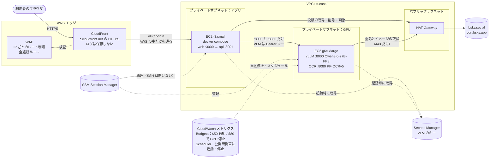

# AWS 移行計画（一般公開に向けて）

- 作成：2026-11-07（同日、チームの決定を反映）
- 状態：計画（AWS のリソースはまだ作っていない）
- 関連：[セキュリティ検査 総合報告書](security/REPORT.md)（対象 commit `df27bac`、PR #110）

## 1. 目的

谷口さんの検査で、アプリに致命的な脆弱性はなかった。一方、インフラ（モデルの公開 URL、キーの管理、公開経路、レート制限、乱用、費用）は検査の範囲外だった。

一般公開にあたって、アプリの外側に残っているリスクを AWS で塞ぐ。11/15 Award Day では次の流れで前後を比べて見せる。

> 一般公開に向けて検査 → アプリは堅かった → 公開のための外側の守りを AWS で整えた → 再検査で確認

変えないこと（安全設計）：

- 写真と本文を第三者の AI サービスに送らない。Bedrock や Vertex などのホスト型 AI は使わず、自分たちの vLLM と OCR を自分たちのインスタンスで動かす
- 診断結果を保存しない。公開中の本番では閲覧リンクの機能もオフにする
- 診断できるのはログインした本人のアカウントだけ

## 2. 今と移行後

| | 今 | 移行後 |
|---|---|---|
| モデル | RunPod の Pod。`https://<POD_ID>-8000.proxy.runpod.net` で**インターネットに公開**し、Bearer キーで保護 | AWS の GPU インスタンス。**プライベートサブネットに置き、インターネットから届かない**。アプリのサーバーからだけ呼べる。OCR も同じインスタンスで動かす |
| web と api | 個人 PC。Cloudflare Tunnel で公開する予定だった | EC2 1台（プライベートサブネット）。既存の `infra/docker-compose.yml` を使う |
| 入口 | Tunnel | CloudFront（HTTPS）＋ WAF だけ |
| レート制限 | なし | WAF（IP ごと）＋アプリ（アカウントごとの1日の回数、同時実行の数） |
| キー | 手元の `.env` | Secrets Manager |
| アクセス記録 | — | 保存しない。WAF のサンプル表示と CloudWatch のメトリクスだけで見張る |
| 費用 | 管理なし | Budgets の通知と GPU の自動停止、公開時間帯だけ GPU を動かす |

## 3. 構成

### 3.1 各リソースを選んだ理由

| リソース | 選んだ理由 |
|---|---|
| CloudFront | 独自ドメインがなくても `*.cloudfront.net` で HTTPS にできる。WAF を付けられる。インターネットに向いた入口をここだけにできる |
| CloudFront **VPC origin** | プライベートサブネットの EC2 に、AWS の中だけを通ってつなげる。アプリの EC2 にパブリック IP が要らない。ログインのパスワードが平文で公開インターネットを流れない（3.2） |
| WAF | IP ごとのレート制限。ログインの総当たりと診断の連打を入口で止める。全遮断のスイッチにも使う。ログは保存せず、サンプル表示（直近3時間分）で見る |
| EC2 t3.small（アプリ） | 既存の compose がそのまま動く。1台で十分（重い処理は GPU 側）。メモリ 2GB |
| EC2 g6e.xlarge（GPU） | L40S 48GB で、今と同じモデル・同じ引数（`--max-num-seqs 8 --max-model-len 8192`、thinking 無効）が動く。OCR も同居させる（3.5）。開発・確認には g6.xlarge（L4 24GB）と `QuantTrio/Qwen3.6-27B-AWQ` も使える |
| NAT Gateway | アプリは Bluesky に、GPU は重みとイメージの取得に、外へ出る必要がある。内向きの通信は受けない |
| Secrets Manager | VLM のキーをコード・`.env`・リポジトリ・Terraform の state に置かない。インスタンスロールで起動時に読む |
| SSM Session Manager | SSH のポートを開けずに入れる。操作の記録も残る |
| CloudWatch メトリクス | CloudFront と WAF のリクエスト数・遮断数・エラー率を、ログを保存せずに見る |
| Budgets ＋ Budgets action | 予算 $100 に対して、$50 で通知、$80 で GPU を自動で止める |
| EventBridge Scheduler | 公開時間帯に合わせて GPU を起動・停止する（止め忘れを防ぐ。6.3） |
| 全遮断用の IAM ユーザー | 予備の担当（谷口さん）が、WAF の全遮断と GPU の停止だけをできるようにする（7章） |

### 3.2 想定していた構成から変えた点

- **ALB をやめて、CloudFront VPC origin で EC2 に直接つなぐ**
  - 独自ドメインがないので、ALB に合う証明書を ACM で取れない。CloudFront → パブリック ALB は HTTP になり、ログイン時の Bluesky のパスワードが CloudFront と ALB の間の公開インターネットを平文で流れる
  - VPC origin なら通信は AWS の中だけを通り、アプリの EC2 も ALB もインターネットに出さずに済む。ALB の費用（約 $0.6/日〜）もかからない
  - 代案：VPC origin → EC2 で SSE が途中で切れるなど問題があれば、**内部** ALB を VPC origin にする（11/10 に確認）
- **NAT Gateway は必要**（なくせない）。アプリが bsky.social と cdn.bsky.app に出るため。費用は 6章
- **GPU の外向き**：セキュリティグループで 443 だけに絞る。さらに固めるなら、セットアップ後に GPU サブネットから NAT への経路を外し、VPC エンドポイント（SSM、Secrets Manager）だけにする（1つ $0.01/時。任意）

### 3.3 アプリの EC2 の設定

- **ポート**：compose は今、`127.0.0.1` にだけ公開している。AWS では web だけを `0.0.0.0:3000` にし（`WEB_BIND` で切り替える）、セキュリティグループで VPC origin からだけ受ける。api（8001）は外に出さず、compose のネットワークの中で web からだけ呼ぶ
- **compose の直書き**：`CORS_ORIGINS` と `MOCK_MODE` が `environment:` に直書きされていて、`.env` より優先される。環境変数で差し替えられるようにする（8章 PR 3）
- **IMDSv2 を必須、hop limit を 1** にする。コンテナからインスタンスのメタデータ（認証情報）に届かないようにする
- **本番の値**：
  - `MOCK_MODE=0`、`COOKIE_SECURE=1`、`CORS_ORIGINS=["https://<配信ID>.cloudfront.net"]`
  - `VLM_BASE_URL=http://<GPU のプライベート IP>:8000/v1`、`OCR_BASE_URL=http://<GPU のプライベート IP>:8080`
  - `MODEL_ALLOWED_HOST_SUFFIXES=<GPU のプライベート IP>`（VLM と OCR の両方がこの IP だけに送れる）
  - `SHARE_ENABLED=0`（閲覧リンクの機能をオフ。既定は 1 で、ローカルでは今までどおり）
  - 公開時間帯（`PUBLIC_WINDOWS`。5.2）
  - キーは Secrets Manager から環境変数で渡す
- GPU のプライベート IP は、インスタンスを止めて起動し直しても変わらない

### 3.4 SSE（`POST /api/diagnose`）が途中の中継で切れないか

経路：ブラウザ → CloudFront → VPC origin → web（Next.js の rewrites）→ api。api はイベントの間が15秒空くと `: keep-alive` を送る（`SSE_KEEPALIVE_SECONDS`）。

| 区間 | 設定 | 判断 |
|---|---|---|
| CloudFront の origin response timeout | 既定30秒、1〜180秒 | 15秒ごとに何か届くので既定でも切れない見込み。余裕を見て60秒にする |
| CloudFront の response completion timeout | 応答全体の上限 | 設定するなら診断の最長時間より長くする（未設定時の挙動は 11/10 に確認） |
| CloudFront のキャッシュと圧縮 | `/api/*` は CachingDisabled、圧縮なし。Cookie・クエリ・本文を転送 | api は `Cache-Control: no-store, no-transform` を返す（検査 7） |
| Next.js の rewrites | proxyTimeout の既定は30秒 | keep-alive が15秒なので切れない見込み。11/10 に実測 |
| ALB（代案のときだけ） | idle timeout の既定60秒 | 15秒より長いので問題なし |

確かめ方：11/10 に MOCK_MODE=1 で `MOCK_EVENT_INTERVAL_SECONDS` を40秒程度に伸ばし、CloudFront の URL に `curl -N` で診断を流す。keep-alive が届き、`done` まで切れないことを見る。11/12 に実際のモデルで長い診断を流す。

### 3.5 OCR を GPU に同居させる

VLM では「写真のどこに書いてあるか」をうまく特定できなかった。OCR は文字ごとの位置を返すので、それを使う。

- **動かし方**：PP-OCRv5 の HTTP サービスを GPU インスタンスの 8080 番で動かす。vLLM の `--gpu-memory-utilization` を下げて OCR の分を空ける（値は 11/11 に計測して決める）
- **使い方**：VLM が文字の手がかり（駅名標、店名、住所など）を見つけた写真だけに OCR をかける。手がかりの文字と OCR の結果を突き合わせて、次の2つに使う
  - 写真の該当箇所の枠（`region`）
  - 読みの二重チェック（VLM と OCR の読みが一致するか）
- **部品**：既存の `detect/src/tkb_detect/ocr_client.py`（文字ごとに位置 `box` を返す）と `detect/src/tkb_detect/ocr_merge.py` を使う
- **守り**：OCR の接続先も送信先ガード（許可リスト）を通る。セキュリティグループは、8080 番もアプリからだけ受ける
- **やめる条件**：11/11 に試し、11/12 までに枠が出なければ OCR を外す（VLM だけで公開する）

## 4. 検査の指摘・範囲外のリスク → 対策 → 確かめ方

発表の前後比較に使う表。

| # | 検査の指摘・範囲外のリスク | 移行前 | AWS・アプリでの対策 | 移行後の確かめ方 |
|---|---|---|---|---|
| 1 | 🟠 モデル送信先ガードが拒否リスト方式（検査 9） | 一覧にないホストやメタデータ IP を通した | #111 で許可リスト方式（`MODEL_ALLOWED_HOST_SUFFIXES`）、169.254/16 などは常に拒否。**残り**：許可リストが空だと拒否リスト方式に戻る → 空なら拒否する。IP は完全一致にする（PR 2） | 許可リストが空・別ホスト・169.254.169.254・似た IP を拒否するテスト。本番の設定で GPU（VLM と OCR）だけを通す |
| 2 | 🟡 rkey の検証が緩い（検査 4） | `%2e%2e` や改行を含む rkey を通した | #112 で文字種を検証済み | 検査 4 の URI を再実行 |
| 3 | ⚠️ `COOKIE_SECURE` が既定オフ（検査 2） | HTTPS 公開で入れ忘れるおそれ | 本番の compose で `COOKIE_SECURE=1`。CloudFront は HTTP を HTTPS にリダイレクト | Cookie に `Secure` が付く。HTTP で開くとリダイレクトされる |
| 4 | レート制限なし（検査 10） | 何回でも呼べた | WAF：全体 300回/5分/IP、`POST /api/session` 10回/5分/IP、`POST /api/diagnose` 5回/5分/IP。アプリ：1アカウント1日3回、同時2診断（5章） | 上限を超えると WAF が 403/429、アプリが 429/503 を返す |
| 5 | モデルの URL が公開されている（範囲外） | `*.proxy.runpod.net` がインターネットから届いた。守りはキーだけ | GPU はプライベートサブネット、パブリック IP なし。8000（VLM）と 8080（OCR）はアプリのセキュリティグループからだけ。VLM のキーも残す | 外から GPU に届かない。アプリから VLM を呼んでもキーがなければ 401 |
| 6 | キーの管理（範囲外） | 手元の `.env` | Secrets Manager。Terraform の state・ユーザーデータ・ログに入れない | state・ユーザーデータ・ログ・リポジトリを grep して、キーがないこと |
| 7 | 公開経路（範囲外） | 個人 PC ＋ Tunnel | 入口は CloudFront だけ。アプリの EC2 はプライベートサブネットで、VPC origin からだけ受ける。SSH は開けない | EC2 に直接つながらない。開いているポートがない |
| 8 | ログインのパスワードの経路（範囲外） | Tunnel の中 | ブラウザ → CloudFront は HTTPS、CloudFront → EC2 は AWS の中だけ | 構成の確認（ALB や平文の公開区間がない） |
| 9 | インスタンスのメタデータ（範囲外） | — | IMDSv2 必須、hop limit 1 | コンテナから 169.254.169.254 に届かない |
| 10 | 乱用・踏み台（範囲外） | — | WAF で `/api/session` を厳しく制限し、Bluesky のパスワード総当たりの踏み台にさせない。本番で 501 の `/api/detect` は WAF で遮断 | 連続ログインが WAF で止まる |
| 11 | 結果の保存（範囲外） | 本人が押せば閲覧リンク用に2時間保存した | 公開中の本番では閲覧リンクの機能をオフ（`SHARE_ENABLED=0`）。CloudFront・WAF のログも保存しない | 閲覧リンクのボタンが出ず、API も使えない。ログの保存先が設定されていない |
| 12 | 費用の暴走（範囲外） | 管理なし | Budgets（$50 通知、$80 で GPU 自動停止）。公開時間帯だけ GPU を動かす | 予算の通知を試しに受ける。スケジュールどおりに GPU が止まる |
| 13 | すぐ止める手段（範囲外） | Tunnel を止める | 全遮断の WAF ルール、GPU の停止（担当は内藤、予備は谷口。谷口さんには最小権限の IAM ユーザー）、CloudFront の無効化、`terraform destroy`（7章） | 訓練で、全遮断までの時間を測る。谷口さんの IAM ユーザーで、それ以外の操作ができないこと |
| 14 | 残課題：SSE 切断時の内部タスクの解放（報告書 5章） | 未検証 | 同時実行の枠を、SSE の generator の finally で必ず返すようにする（PR 4） | 実際のモデルで長い診断を途中で切り、vLLM の `num_requests_running` が0に戻り、枠が返ること |

## 5. 乱用対策と公開時間外（アプリ側）

### 5.1 値の案

前提：1回の診断は投稿を4件ずつ並列に処理する（`detect/src/tkb_detect/batch.py` の `CONCURRENCY = 4`）。vLLM は `--max-num-seqs 8`。同時に2診断で GPU が埋まる。

| 設定 | 仮の値 | 動き |
|---|---|---|
| `DIAGNOSE_DAILY_LIMIT` | 3 | アカウント（DID）ごと、日本時間の1日あたり。メモリだけに持ち、再起動で消えてよい。超えたら 429「今日の診断回数の上限に達しました」 |
| `MAX_CONCURRENT_DIAGNOSES` | 2 | 空きを待たずに確かめる。空きがなければ 503 と `Retry-After`、「混雑しています。しばらくしてからもう一度お試しください」 |
| 同じセッションでの同時診断 | 1 | 診断中にもう1つ始めたら 409 |

- 値は仮。11/11 に実際の診断時間を測って見直す
- 回数は、同時実行の枠を取れたときだけ数える（混雑で断られた分は数えない）
- 枠は SSE の generator の finally で必ず返す。利用者が途中でページを閉じても枠が戻るようにする
- `/api/simulate` はモデルを呼ばないので制限しない。`/api/delete` は Bluesky 側の書き込みの制限（5000点/時）で十分

### 5.2 公開時間外・GPU 停止中

- 公開時間帯を設定（`PUBLIC_WINDOWS`。日本時間の開始・終了の一覧）から読む
- 公開時間外に診断を始めたら、503 と次の公開の開始時刻を返す。画面に「公開時間外です。次は11月16日の20:00からです」のように出す。最後の公開が終わったあとは「公開は終了しました」
- 公開時間内でも GPU に接続できないとき（止まっている、起動中）は、503 と「ただいま準備中です。しばらくしてからもう一度お試しください」
- 開始時刻は設定から作り、文言に時刻を直書きしない

## 6. 公開期間・時間帯と費用

### 6.1 単価の目安

オンデマンド、us-east-1。**料金計算ツールで確認すること**。

| 項目 | 単価の目安 | 備考 |
|---|---|---|
| g6e.xlarge | 約 $1.86/時 | 本番 |
| g6.xlarge | 約 $0.81/時 | 開発・確認。AWQ |
| t3.small | 約 $0.50/日 | アプリ |
| NAT Gateway | 約 $1.08/日 ＋ $0.045/GB | 重み約30GB とイメージで約 $2 |
| NAT のパブリック IP | 約 $0.12/日 | |
| EBS gp3 | 約 $0.35/日 | GPU 100GB ＋ アプリ 30GB |
| WAF | 約 $0.30/日 ＋ $0.60/100万リクエスト | ACL $5/月、ルール $1/月。ログは保存しないので保存の費用はない |
| CloudFront | ほぼ $0 | 無料枠（1TB/月）の中。画像は利用者のブラウザが cdn.bsky.app から直接読む |
| Secrets Manager | 約 $0.40/月 | |
| Budgets、Scheduler、SSM、CloudWatch の標準メトリクス | $0 | |

常時かかる分は**約 $2.4/日**。11/10〜11/19 の10日間で約 $24。NAT の転送が約 $2。開発とリハーサルの GPU（g6 6時間、g6e 8時間）で約 $20。ここまでで約 $46。

### 6.2 選択肢と決定

**決定：案 E**（g6e.xlarge）。各案の合計は、上の約 $46 に GPU の分を足したもの。

| 案 | 内容 | GPU | 合計の目安 | 判定 |
|---|---|---|---|---|
| A | g6e を24時間×7日 | 約 $313 | 約 $359 | ✗ 予算超え |
| B | g6（AWQ）を24時間×7日 | 約 $135 | 約 $181 | ✗ 予算超え |
| C | g6e を毎晩3時間×7日 | 約 $39 | 約 $85 | △ 余裕が少ない |
| D | g6（AWQ）を毎晩3時間×7日 | 約 $17 | 約 $63 | AWQ の精度と速度を別に確かめる必要がある |
| **E** | **g6e を Award Day ＋ 3晩×2時間** | **約 $24** | **約 $70** | **決定** |
| F | Award Day だけ（一般公開はしない） | 約 $11 | 約 $57 | — |

E の GPU の分は、Award Day に約6時間、3晩はそれぞれ起動の15分前から2時間15分として計算した。

### 6.3 公開のスケジュール（決定）

日本時間。GPU の起動・停止は EventBridge Scheduler で行う（Award Day は手動）。

| 日 | 公開時間 | GPU の起動 | GPU の停止 |
|---|---|---|---|
| 11/15（日）Award Day | 当日の発表に合わせる（時間はタイムテーブルが出たら決める） | 手動 | 手動 |
| 11/16（月） | 20:00〜22:00 | 19:45（自動） | 22:00（自動） |
| 11/17（火） | 20:00〜22:00 | 19:45（自動） | 22:00（自動） |
| 11/18（水） | 20:00〜22:00 | 19:45（自動） | 22:00（自動）。これで公開を終える |

- GPU を起動してから vLLM が使えるまで数分かかるので、15分前に起動する
- インスタンスは「停止」にする（「終了」にしない）。EBS の重みを残して、次の起動を速くする
- スポットインスタンスは中断されるので使わない
- アプリの `PUBLIC_WINDOWS` にも同じ時間帯を入れる（5.2）

### 6.4 GPU の上限が間に合わない場合

- GPU の上限（`L-DB2E81BA`、Running On-Demand G and VT instances、us-east-1）は 11/7 に 8 vCPU で申請済み。審査中
- **11/11 までに通らなければ、本番のモデルは RunPod のまま発表する**。その場合の構成：
  - web と api は予定どおり AWS（CloudFront、WAF、プライベートサブネットの EC2）に置く
  - `VLM_BASE_URL` は RunPod の URL、`MODEL_ALLOWED_HOST_SUFFIXES=<POD_ID>-8000.proxy.runpod.net`（Pod ごとのホスト名まで書く。`proxy.runpod.net` だけだと、RunPod のほかの利用者の Pod にも送れてしまう）。キーは Secrets Manager に置く
  - 残るリスク：モデルの URL がインターネットに公開されたまま（守りはキーだけ）。4章の 5 は「未対策」として発表で正直に示す
  - OCR は RunPod の Pod に同居させるか、外す

## 7. すぐ止める手順

速い順。どれも今は実行しない。手順書（`infra/terraform/README.md`）に、実際のコマンドを書く。

| 順 | 手段 | かかる時間 | 結果 | できる人 |
|---|---|---|---|---|
| 1 | WAF の「全遮断」ルール（ふだんは無効にしておく）を有効にする | 約1分 | すべてのアクセスが 403 | 内藤、谷口 |
| 2 | GPU を止める（`aws ec2 stop-instances`） | 約1分 | 画面は開けるが、診断は 503 | 内藤、谷口 |
| 3 | CloudFront の配信を無効にする | 数分〜15分 | URL につながらない | 内藤 |
| 4 | `terraform destroy` | 十数分 | すべて消える（費用も止まる） | 内藤 |

- **担当**：第一担当は内藤、予備は谷口
- **谷口さん用の IAM ユーザー**：Terraform で作る。できるのは次の2つだけ
  - WAF の全遮断ルールの切り替え（この Web ACL の取得と更新だけ）
  - タグ `Project=tkb_2613` の GPU インスタンスの停止（`ec2:StopInstances` をタグの条件で絞る。一覧のための `ec2:DescribeInstances` は付ける）
- 予算が $80 を超えたら、Budgets action が自動で GPU を止める

日ごとの当番（11/11 のミーティングで決める）：

| 日 | 当番 |
|---|---|
| 11/15（日） | |
| 11/16（月） | |
| 11/17（火） | |
| 11/18（水） | |

## 8. コード側の修正

それぞれ main からブランチを切って、別の PR にする。PR 3 以降は、PR 2 を確認してもらってから進める。

| PR | ブランチ | 内容 | テスト |
|---|---|---|---|
| 2 | `fix/guard-fail-closed`（#114） | `detect/src/tkb_detect/guard.py`：許可リストが空なら、loopback 以外を拒否する（拒否リスト方式に戻さない）。IP を許可リストに書いたときは完全一致にする。169.254.0.0/16 は常に拒否。api は `.env` から読んだ許可リストを VLM と OCR に渡す（uvicorn で直接起動すると `.env` がガードに届いていなかった）。`.env.example` の説明を直す（RunPod は Pod ごとのホスト名まで書く） | `detect/tests/test_guard.py`、`test_extract.py`、`api/tests/test_diagnose.py` |
| 3 | `chore/compose-aws` | `infra/docker-compose.yml` の `CORS_ORIGINS`、`MOCK_MODE`、`COOKIE_SECURE`、web のバインド先（`WEB_BIND`）を環境変数で差し替えられるようにする。`infra/README.md` に本番の値を書く | `docker compose config` で値が入ること |
| 4 | `feat/diagnose-limits` | 乱用対策（5.1）と公開時間外の表示（5.2）。`api/src/tkb_api/limits.py`（新規）、`config.py`、`routes/diagnose.py`。`docs/api-sse-contract.md` と web の型・表示（429・503・409 と次の公開時刻）を同時に変える | 上限の境界、日付の切り替わり、枠の解放（切断時も）、公開時間の内外と最後の公開の後 |
| 5 | `feat/share-toggle` | `SHARE_ENABLED`（既定 1）。0 なら閲覧リンクの API を 404 にし、画面のボタンを出さない | オン・オフ両方 |
| 6 | `feat/legal-pages` | 利用者向けのページ（9章） | 画面のテスト |
| 7 | `feat/ocr-region` | OCR で写真の該当箇所の枠と読みの二重チェック（3.5）。11/11 に試し、11/12 までに枠が出なければ入れない | 突き合わせのテスト（モックの OCR 結果） |
| 8 | `feat/terraform` | `infra/terraform/`（10章）。`terraform plan` まで。apply は別に承認を得てから。**VLM のキーをコンテナに渡す方法もここで決める**（10.1） | `terraform validate`、`plan` |

`is_own_post_uri` の rkey 検証は #112 で済んでいるので、新しい PR は要らない。

## 9. 利用者向けのページ

web に「利用規約」「プライバシーポリシー」「問い合わせ」を足し、全画面のフッターからリンクする。ログイン画面にも要点を出す。

書くこと：

- **何を送るか**：ログインした本人の直近 30 件の投稿（本文、写真、投稿時刻）を、チームが管理するサーバー（AWS 上の自分たちの GPU）に送って読む。第三者の AI サービスには送らない
- **何を保存しないか**：
  - パスワードはログインに使ったら捨てる
  - Bluesky のセッションはサーバーのメモリだけに置き、30分かログアウトで消える
  - **診断結果は保存しない**。写真も保存しない
- **IP アドレス**：IP アドレスは攻撃を防ぐために一時的に処理するだけで、保存しない
- **アプリパスワード**：アプリパスワードでのログインを勧める。使い終わったら Bluesky の設定から取り消すよう案内し、設定画面への行き方を書く
- **結果は推定**であり、正しいとは限らない。削除は本人が選んで確認したときだけ行い、元に戻せない
- **上限**：1日の回数と混雑時の待ちについて
- **公開期間・時間帯**（6.3）と、予告なく止めることがあること
- **問い合わせ**：GitHub の Issue（https://github.com/jphacks/tkb_2613/issues ）へのリンクだけ。「個人に関わる内容は Issue に書かないでください」と添える

## 10. IaC の方針

**Terraform を使う**（`infra/terraform/`）。

- `terraform destroy` 1回で、作ったものがすべて消える。CDK は bootstrap のスタック（S3 バケット、IAM ロール）がアカウントに残る
- **state はローカル（内藤の PC）に置く**。`.gitignore` で除外する。apply のたびに、リポジトリの外へコピーする（手順を `infra/terraform/README.md` に書く）
- **秘密の値は Terraform で扱わない**。Secrets Manager の「入れ物」だけを Terraform で作り、値はコンソールか CLI で別に入れる（state に値が入らないようにする）
- 変数で切り替える：`gpu_instance_type`（g6e / g6）、`waf_block_all`（全遮断）、公開時間帯のスケジュール（6.3）
- 谷口さん用の最小権限の IAM ユーザー（7章）も Terraform で作る。アクセスキーは Terraform の出力に出さず、コンソールで別に発行して本人に渡す
- CloudFront と WAF のログの保存先は作らない
- 全リソースにタグ（`Project=tkb_2613`）を付ける。消し忘れを Cost Explorer とタグで確かめられるようにする
- GPU のイメージは AWS Deep Learning AMI（NVIDIA ドライバと Docker 入り）。vLLM は RunPod と同じバージョンのコンテナイメージを固定して使う。OCR も同じインスタンスでコンテナとして動かす

### 10.1 VLM のキーをコンテナに渡す方法（PR 8 で決める）

PR #115 のレビューで見つけた点：compose の api は `env_file`（リポジトリ直下の `.env`）からしか値を受け取らない。起動スクリプトがシェルで `export VLM_API_KEY=...` しても、コンテナには届かない。キーを `.env` に書くと、EC2 のディスクに平文で残る。

候補は次の2つ。PR 8 で比べて決める。

| 案 | 内容 | よい点 | 気をつける点 |
|---|---|---|---|
| A | compose の api に `environment: VLM_API_KEY: ${VLM_API_KEY}` を足す。起動スクリプトが Secrets Manager から読んで、`docker compose up` のときだけ環境変数で渡す | api のコードを変えない | `docker inspect` でコンテナの環境変数として見える。起動スクリプトの履歴やログに出さないようにする。キーを変えたらコンテナを作り直す |
| B | api が起動時に、インスタンスロールで Secrets Manager を直接読む（`VLM_API_KEY_SECRET_ID` を設定） | キーがファイルにも環境変数にも出ない | api に boto3 などの依存が増える。コンテナから IMDS に届かない設定（hop limit 1、3.3）と両立させる必要がある（hop limit を 2 にするか、認証情報を別の方法で渡す） |

- どちらの案でも、キーを `.env`・ユーザーデータ・Terraform の state・ログに入れない（4章の 6）
- 再検査（13.2）で、`docker inspect`・`/proc/<pid>/environ`・ログにキーが出ないかを確かめる

## 11. Bluesky の API の回数制限

[Bluesky の公式文書](https://docs.bsky.app/docs/advanced-guides/rate-limits)より（値は変わることがある）。

| 制限 | 値 | 単位 | この作品への影響 |
|---|---|---|---|
| createSession（ログイン） | 30回/5分、300回/日 | アカウント（ハンドル） | 利用者ごとなので通常は問題ない。entryway（bsky.social）では100回/日という報告がある |
| API 全体 | 3000回/5分 | IP | 全員の通信が NAT の1つの IP から出る。1回の診断は数リクエスト（ログイン、投稿の取得1回、削除は最大3件）なので、600診断/5分までは届かない。GPU の上限のほうが先に来る |
| 書き込み | 5000点/時、35000点/日 | アカウント | 削除は最大3件なので問題ない |
| cdn.bsky.app（画像） | 公開されていない | — | 1回の診断で最大120枚（30件×4枚）。429 が出ないか監視する |

**問題になりそうな点**：うちのサーバーが Bluesky のパスワード総当たりの踏み台にされると、共有の送信元 IP が Bluesky に制限され、全員がログインできなくなる。対策は WAF で `POST /api/session` を IP ごとに10回/5分に絞ること。Bluesky から 429 が返ったら、画面に「Bluesky が混雑しています」と出す（今のエラー処理で足りるかは PR 4 で確認する）。

## 12. 作業手順（日付つき）

| 日付 | 作業 |
|---|---|
| 11/7（土） | この計画の PR。GPU の上限を申請（済み、審査中）。PR 2（ガード） |
| 11/8（日） | PR 3（compose）、PR 4（乱用対策と公開時間外）、PR 5（閲覧リンクの切り替え） |
| 11/9（月） | PR 6（利用者向けのページ）、PR 8（Terraform を plan まで） |
| 11/10（火） | apply：VPC、アプリの EC2、CloudFront、WAF、Budgets、谷口さんの IAM ユーザー（GPU なし、MOCK_MODE=1）。CloudFront を通した SSE を確認（3.4） |
| 11/11（水） | **GPU の上限の結果を確認**（通らなければ 6.4）。g6.xlarge（AWQ）で GPU を立てる。重みの取得、プライベート接続、実際の診断。診断時間を測って 5.1 の値を見直す。OCR の同居と枠を試す（PR 7）。ミーティングで当番を決める |
| 11/12（木） | g6e.xlarge で本番の構成。**OCR の枠が出なければ外す**。再検査（13章）。SSE 切断時の解放の確認。全遮断の訓練（内藤と谷口） |
| 11/13（金） | **機能追加を止める**。通し練習。再検査の報告（`docs/security/RECHECK.md`） |
| 11/14（土） | 通し練習。公開時間帯のスケジュールを設定 |
| 11/15（日） | Award Day。公開 |
| 11/16〜11/18 | 20:00〜22:00 に公開 |
| 11/18（水）22:00 | GPU を停止。公開を終える |
| 11/19（木） | 記録用のスクリーンショット（WAF のグラフ、Budgets の実績、構成）を撮る → `terraform destroy`。RunPod の Pod を Terminate し、RunPod のキーを無効にする |
| 11/20（金） | 請求とタグで消し忘れがないか確かめる |

## 13. 移行後の再検査

### 13.1 谷口さんの12カテゴリから

| # | カテゴリ | やること |
|---|---|---|
| 1 | 認証境界 | CloudFront 経由で回帰の確認（未認証・偽造 Cookie が 401） |
| 2 | セッション・Cookie | **再実行**。`Secure` が付くこと |
| 3 | 認可・IDOR | 回帰の確認 |
| 4 | at:// URI 検証 | **再実行**（#112 の確認） |
| 5 | 入力検証 | 回帰の確認。WAF の managed rule が正しい要求を止めないこと |
| 6 | 情報漏えい | 回帰の確認。CloudFront・WAF のエラー画面に内部の情報が出ないこと |
| 7 | キャッシュ・ヘッダ | **再実行**。CloudFront を通しても `no-store, no-transform` が届き、キャッシュされないこと |
| 8 | CORS | **再実行**。CloudFront のオリジンだけ許可 |
| 9 | 送信先ガード | **再実行**。許可リストが空のときの拒否、169.254.169.254、似た IP。VLM と OCR の両方 |
| 10 | レート制限・過負荷 | **再実行**。WAF の 403/429、アプリの 429/503 |
| 11 | プロンプトインジェクション | 新しい GPU で数件だけ再実行 |
| 12 | SSE | **再実行**。CloudFront と Next.js を通した keep-alive と長い診断 |

### 13.2 追加：インフラ

- GPU にパブリック IP がなく、外から届かない
- GPU の 8000 番（VLM）と 8080 番（OCR）には、アプリのセキュリティグループからだけ届く。VLM はキーなしで呼ぶと 401
- アプリの EC2 に直接つながらない（CloudFront 経由だけ）
- 開いている SSH のポートがない。SSM で入れる
- IMDSv2 必須で、コンテナからメタデータに届かない
- キーが Terraform の state・ユーザーデータ・ログ・リポジトリにない
- HTTPS だけ（HTTP はリダイレクト）。TLS 1.2 以上
- CloudFront と WAF のログの保存先が設定されていない
- 谷口さんの IAM ユーザーで、全遮断と GPU の停止はでき、それ以外（ほかのインスタンスの停止、設定の変更など）はできない

### 13.3 追加：乱用、公開時間、費用

- WAF の各ルールが効く（ログイン、診断、全体）
- 1日の上限、同時実行の上限、同じセッションでの同時診断
- 公開時間外と GPU 停止中に、次の公開時刻つきのメッセージが出る
- 閲覧リンクの機能がオフになっている
- Budgets の通知が届く。GPU の自動停止とスケジュールどおりの起動・停止
- 全遮断の訓練（かかった時間を記録する）

### 13.4 報告書の残課題

- **SSE 切断時の内部タスクの解放**：実際のモデルで長い診断を始め、途中でページを閉じる。vLLM の `/metrics` の `vllm:num_requests_running` が0に戻ること、同時実行の枠が返ること、api のログに例外が出ないこと
- 実際の Bluesky での削除：消えてよいデモ用の投稿で、画面から1件だけ確かめる

## 14. 決定事項と残り

### 14.1 決定（2026-11-07、チームと内藤）

| # | 項目 | 決定 | 反映した章 |
|---|---|---|---|
| 1 | AWS のアカウント | 内藤のアカウント（確認済み） | — |
| 2 | GPU の上限 | 11/7 に 8 vCPU で申請、審査中。11/11 までに通らなければ本番は RunPod | 6.4、12 |
| 3 | 公開期間 | 案 E。11/15 Award Day ＋ 11/16〜11/18 の 20:00〜22:00（日本時間）。g6e.xlarge | 6.2、6.3 |
| 4 | 閲覧リンク | 公開中の本番ではオフ（`SHARE_ENABLED=0`）。ローカルの既定は今までどおり | 3.3、8、9 |
| 5 | アクセス記録 | CloudFront・WAF のログは保存しない。WAF のサンプル表示と CloudWatch のメトリクスで見張る | 3.1、9、10 |
| 6 | 問い合わせ先 | GitHub の Issue へのリンクだけ。個人に関わる内容は書かないよう添える | 9 |
| 7 | OCR | 入れる。GPU に同居。11/11 に試し、11/12 までに枠が出なければ外す | 3.5、8、12、13 |
| 8 | Terraform の state | ローカル（内藤の PC）。`.gitignore` で除外し、apply のたびにリポジトリの外へコピー | 10 |
| 9 | 乱用対策の値 | 1日3回、同時2は仮の値。11/11 に見直す | 5.1 |
| 10 | 全遮断の担当 | 第一担当は内藤、予備は谷口。谷口さん用に最小権限の IAM ユーザー | 7、10 |
| 11 | 公開時間外の表示 | 「公開時間外です。次は○月○日の20:00からです」。時刻は設定から読む | 5.2 |
| 12 | 全部消す日 | 11/18 22:00 に GPU 停止 → 11/19 に記録を撮ってから destroy、RunPod の Pod とキーも無効化 → 11/20 に請求とタグで確認 | 12 |

### 14.2 残り

- 日ごとの当番（11/11 のミーティングで決める。7章の表）
- Award Day の公開時間（タイムテーブルが出たら決める。6.3）
- GPU の上限の審査結果（11/11 に確認）
- vLLM の `--gpu-memory-utilization` の値（11/11 に計測）

## 出典

- Bluesky：[Rate Limits](https://docs.bsky.app/docs/advanced-guides/rate-limits)、[Rate Limits, PDS v3](https://docs.bsky.app/blog/rate-limits-pds-v3)、[entryway の上限についての issue](https://github.com/bluesky-social/bsky-docs/issues/183)
- CloudFront：[VPC origins への移行](https://aws.amazon.com/blogs/networking-and-content-delivery/migrate-amazon-cloudfront-public-origins-to-private-vpc-origins)、[origin のタイムアウト（CDK の VpcOrigin）](https://docs.aws.amazon.com/cdk/api/v2/python/aws_cdk.aws_cloudfront_origins/VpcOrigin.html)、[504 Gateway Timeout](https://docs.aws.amazon.com/AmazonCloudFront/latest/DeveloperGuide/http-504-gateway-timeout.html)
- 費用：各サービスの料金ページと AWS Pricing Calculator（6章の値は目安。確定前に確認する）
