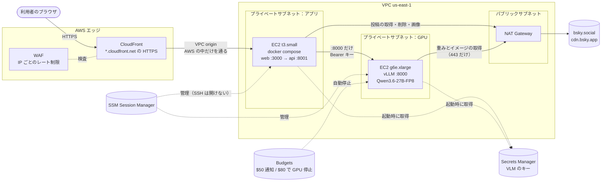

# AWS 移行計画（一般公開に向けて）

- 作成：2026-11-07
- 状態：計画（AWS のリソースはまだ作っていない）
- 関連：[セキュリティ検査 総合報告書](security/REPORT.md)（対象 commit `df27bac`、PR #110）

## 1. 目的

谷口さんの検査で、アプリに致命的な脆弱性はなかった。一方、インフラ（モデルの公開 URL、キーの管理、公開経路、レート制限、乱用、費用）は検査の範囲外だった。

一般公開にあたって、アプリの外側に残っているリスクを AWS で塞ぐ。11/15 Award Day では次の流れで前後を比べて見せる。

> 一般公開に向けて検査 → アプリは堅かった → 公開のための外側の守りを AWS で整えた → 再検査で確認

変えないこと（安全設計）：

- 写真と本文を第三者の AI サービスに送らない。Bedrock や Vertex などのホスト型 AI は使わず、自分たちの vLLM を自分たちのインスタンスで動かす
- 診断結果を保存しない（例外は、本人が「閲覧リンクを作る」を押したときの2時間だけ）
- 診断できるのはログインした本人のアカウントだけ

## 2. 今と移行後

| | 今 | 移行後 |
|---|---|---|
| モデル | RunPod の Pod。`https://<POD_ID>-8000.proxy.runpod.net` で**インターネットに公開**し、Bearer キーで保護 | AWS の GPU インスタンス。**プライベートサブネットに置き、インターネットから届かない**。アプリのサーバーからだけ呼べる |
| web と api | 個人 PC。Cloudflare Tunnel で公開する予定だった | EC2 1台（プライベートサブネット）。既存の `infra/docker-compose.yml` を使う |
| 入口 | Tunnel | CloudFront（HTTPS）＋ WAF だけ |
| レート制限 | なし | WAF（IP ごと）＋アプリ（アカウントごとの1日の回数、同時実行の数） |
| キー | 手元の `.env` | Secrets Manager |
| 費用 | 管理なし | Budgets の通知と GPU の自動停止、公開時間帯だけ GPU を動かす |

## 3. 構成

### 3.1 各リソースを選んだ理由

| リソース | 選んだ理由 |
|---|---|
| CloudFront | 独自ドメインがなくても `*.cloudfront.net` で HTTPS にできる。WAF を付けられる。インターネットに向いた入口をここだけにできる |
| CloudFront **VPC origin** | プライベートサブネットの EC2 に、AWS の中だけを通ってつなげる。アプリの EC2 にパブリック IP が要らない。ログインのパスワードが平文で公開インターネットを流れない（3.2） |
| WAF | IP ごとのレート制限。ログインの総当たりと診断の連打を入口で止める。全遮断のスイッチにも使う |
| EC2 t3.small（アプリ） | 既存の compose がそのまま動く。1台で十分（重い処理は GPU 側）。メモリ 2GB |
| EC2 g6e.xlarge（GPU） | L40S 48GB で、今と同じモデル・同じ引数（`--max-num-seqs 8 --max-model-len 8192`、thinking 無効）が動く。開発・確認には g6.xlarge（L4 24GB）と `QuantTrio/Qwen3.6-27B-AWQ` も使える |
| NAT Gateway | アプリは Bluesky に、GPU は重みとイメージの取得に、外へ出る必要がある。内向きの通信は受けない。公開期間だけ作る |
| Secrets Manager | VLM のキーをコード・`.env`・リポジトリ・Terraform の state に置かない。インスタンスロールで起動時に読む |
| SSM Session Manager | SSH のポートを開けずに入れる。操作の記録も残る |
| Budgets ＋ Budgets action | 予算 $100 に対して、$50 で通知、$80 で GPU を自動で止める |
| EventBridge Scheduler | 公開時間帯に合わせて GPU を起動・停止する（止め忘れを防ぐ） |

### 3.2 想定していた構成から変えた点

- **ALB をやめて、CloudFront VPC origin で EC2 に直接つなぐ**
  - 独自ドメインがないので、ALB に合う証明書を ACM で取れない。CloudFront → パブリック ALB は HTTP になり、ログイン時の Bluesky のパスワードが CloudFront と ALB の間の公開インターネットを平文で流れる
  - VPC origin なら通信は AWS の中だけを通り、アプリの EC2 も ALB もインターネットに出さずに済む。ALB の費用（約 $0.6/日〜）もかからない
  - 代案：VPC origin → EC2 で SSE が途中で切れるなど問題があれば、**内部** ALB を VPC origin にする（11/10 に確認）
- **NAT Gateway は必要**（なくせない）。アプリが bsky.social と cdn.bsky.app に出るため。費用は 6章
- **GPU の外向き**：セキュリティグループで 443 だけに絞る。さらに固めるなら、セットアップ後に GPU サブネットから NAT への経路を外し、VPC エンドポイント（SSM、Secrets Manager）だけにする（1つ $0.01/時。任意）

### 3.3 アプリの EC2 の設定

- **ポート**：compose は今、`127.0.0.1` にだけ公開している。AWS では web だけを `0.0.0.0:3000` にし（`WEB_BIND` で切り替える）、セキュリティグループで VPC origin からだけ受ける。api（8001）は外に出さず、compose のネットワークの中で web からだけ呼ぶ
- **compose の直書き**：`CORS_ORIGINS` と `MOCK_MODE` が `environment:` に直書きされていて、`.env` より優先される。環境変数で差し替えられるようにする（8章 PR 3）
- **IMDSv2 を必須、hop limit を 1** にする。コンテナからインスタンスのメタデータ（認証情報）に届かないようにする
- **本番の値**：`MOCK_MODE=0`、`COOKIE_SECURE=1`、`CORS_ORIGINS=["https://<配信ID>.cloudfront.net"]`、`VLM_BASE_URL=http://<GPU のプライベート IP>:8000/v1`、`MODEL_ALLOWED_HOST_SUFFIXES=<GPU のプライベート IP>`。キーは Secrets Manager から環境変数で渡す
- GPU のプライベート IP は、インスタンスを止めて起動し直しても変わらない

### 3.4 SSE（`POST /api/diagnose`）が途中の中継で切れないか

経路：ブラウザ → CloudFront → VPC origin → web（Next.js の rewrites）→ api。api はイベントの間が15秒空くと `: keep-alive` を送る（`SSE_KEEPALIVE_SECONDS`）。

| 区間 | 設定 | 判断 |
|---|---|---|
| CloudFront の origin response timeout | 既定30秒、1〜180秒 | 15秒ごとに何か届くので既定でも切れない見込み。余裕を見て60秒にする |
| CloudFront の response completion timeout | 応答全体の上限 | 設定するなら診断の最長時間より長くする（未設定時の挙動は 11/10 に確認） |
| CloudFront のキャッシュと圧縮 | `/api/*` は CachingDisabled、圧縮なし。Cookie・クエリ・本文を転送 | api は `Cache-Control: no-store, no-transform` を返す（検査 7） |
| Next.js の rewrites | proxyTimeout の既定は30秒 | keep-alive が15秒なので切れない見込み。11/10 に実測 |
| ALB（代案のときだけ） | idle timeout の既定60秒 | 15秒より長いので問題なし |

確かめ方：11/10 に MOCK_MODE=1 で `MOCK_EVENT_INTERVAL_SECONDS` を40秒程度に伸ばし、CloudFront の URL に `curl -N` で診断を流す。keep-alive が届き、`done` まで切れないことを見る。11/12 に実際のモデルで長い診断を流す。

## 4. 検査の指摘・範囲外のリスク → 対策 → 確かめ方

発表の前後比較に使う表。

| # | 検査の指摘・範囲外のリスク | 移行前 | AWS・アプリでの対策 | 移行後の確かめ方 |
|---|---|---|---|---|
| 1 | 🟠 モデル送信先ガードが拒否リスト方式（検査 9） | 一覧にないホストやメタデータ IP を通した | #111 で許可リスト方式（`MODEL_ALLOWED_HOST_SUFFIXES`）、169.254/16 などは常に拒否。**残り**：許可リストが空だと拒否リスト方式に戻る → 空なら拒否する。IP は完全一致にする（PR 2） | 許可リストが空・別ホスト・169.254.169.254・似た IP を拒否するテスト。本番の設定で GPU だけを通す |
| 2 | 🟡 rkey の検証が緩い（検査 4） | `%2e%2e` や改行を含む rkey を通した | #112 で文字種を検証済み | 検査 4 の URI を再実行 |
| 3 | ⚠️ `COOKIE_SECURE` が既定オフ（検査 2） | HTTPS 公開で入れ忘れるおそれ | 本番の compose で `COOKIE_SECURE=1`。CloudFront は HTTP を HTTPS にリダイレクト | Cookie に `Secure` が付く。HTTP で開くとリダイレクトされる |
| 4 | レート制限なし（検査 10） | 何回でも呼べた | WAF：全体 300回/5分/IP、`POST /api/session` 10回/5分/IP、`POST /api/diagnose` 5回/5分/IP。アプリ：1アカウント1日3回、同時2診断（5章） | 上限を超えると WAF が 403/429、アプリが 429/503 を返す |
| 5 | モデルの URL が公開されている（範囲外） | `*.proxy.runpod.net` がインターネットから届いた。守りはキーだけ | GPU はプライベートサブネット、パブリック IP なし。8000 はアプリのセキュリティグループからだけ。キーも残す | 外から GPU に届かない。アプリから呼んでもキーがなければ 401 |
| 6 | キーの管理（範囲外） | 手元の `.env` | Secrets Manager。Terraform の state・ユーザーデータ・ログに入れない | state・ユーザーデータ・ログ・リポジトリを grep して、キーがないこと |
| 7 | 公開経路（範囲外） | 個人 PC ＋ Tunnel | 入口は CloudFront だけ。アプリの EC2 はプライベートサブネットで、VPC origin からだけ受ける。SSH は開けない | EC2 に直接つながらない。開いているポートがない |
| 8 | ログインのパスワードの経路（範囲外） | Tunnel の中 | ブラウザ → CloudFront は HTTPS、CloudFront → EC2 は AWS の中だけ | 構成の確認（ALB や平文の公開区間がない） |
| 9 | インスタンスのメタデータ（範囲外） | — | IMDSv2 必須、hop limit 1 | コンテナから 169.254.169.254 に届かない |
| 10 | 乱用・踏み台（範囲外） | — | WAF で `/api/session` を厳しく制限し、Bluesky のパスワード総当たりの踏み台にさせない。本番で 501 の `/api/detect` は WAF で遮断 | 連続ログインが WAF で止まる |
| 11 | 費用の暴走（範囲外） | 管理なし | Budgets（$50 通知、$80 で GPU 自動停止）。公開時間帯だけ GPU を動かす | 予算の通知を試しに受ける。スケジュールどおりに GPU が止まる |
| 12 | すぐ止める手段（範囲外） | Tunnel を止める | 全遮断の WAF ルール、GPU の停止、CloudFront の無効化、`terraform destroy`（7章） | 訓練で、全遮断までの時間を測る |
| 13 | 残課題：SSE 切断時の内部タスクの解放（報告書 5章） | 未検証 | 同時実行の枠を、SSE の generator の finally で必ず返すようにする（PR 4） | 実際のモデルで長い診断を途中で切り、vLLM の `num_requests_running` が0に戻り、枠が返ること |

## 5. 乱用対策（アプリ側）の値の案

前提：1回の診断は投稿を4件ずつ並列に処理する（`detect/src/tkb_detect/batch.py` の `CONCURRENCY = 4`）。vLLM は `--max-num-seqs 8`。同時に2診断で GPU が埋まる。

| 設定 | 案 | 動き |
|---|---|---|
| `DIAGNOSE_DAILY_LIMIT` | 3 | アカウント（DID）ごと、日本時間の1日あたり。メモリだけに持ち、再起動で消えてよい。超えたら 429「今日の診断回数の上限に達しました」 |
| `MAX_CONCURRENT_DIAGNOSES` | 2 | 空きを待たずに確かめる。空きがなければ 503 と `Retry-After`、「混雑しています。しばらくしてからもう一度お試しください」 |
| 同じセッションでの同時診断 | 1 | 診断中にもう1つ始めたら 409 |

- 回数は、同時実行の枠を取れたときだけ数える（混雑で断られた分は数えない）
- 枠は SSE の generator の finally で必ず返す。利用者が途中でページを閉じても枠が戻るようにする
- 実際の診断にかかる時間を 11/11 に測り、値を見直す
- `/api/simulate` はモデルを呼ばないので制限しない。`/api/delete` は Bluesky 側の書き込みの制限（5000点/時）で十分

## 6. 公開期間・時間帯と費用

### 6.1 単価の目安

オンデマンド、us-east-1。**料金計算ツールで確認すること**。

| 項目 | 単価の目安 | 備考 |
|---|---|---|
| g6e.xlarge | 約 $1.86/時 | 本番 |
| g6.xlarge | 約 $0.81/時 | 開発・確認。AWQ |
| t3.small | 約 $0.50/日 | アプリ |
| NAT Gateway | 約 $1.08/日 ＋ $0.045/GB | 重み約30GB とイメージで約 $2 |
| NAT のパブリック IP | 約 $0.12/日 | |
| EBS gp3 | 約 $0.35/日 | GPU 100GB ＋ アプリ 30GB |
| WAF | 約 $0.30/日 ＋ $0.60/100万リクエスト | ACL $5/月、ルール $1/月 |
| CloudFront | ほぼ $0 | 無料枠（1TB/月）の中。画像は利用者のブラウザが cdn.bsky.app から直接読む |
| Secrets Manager | 約 $0.40/月 | |
| Budgets、Scheduler、SSM | $0 | |

常時かかる分は**約 $2.4/日**。11/10〜11/21 の12日間で約 $29。開発とリハーサルの GPU（g6 6時間、g6e 8時間）で約 $20。

### 6.2 選択肢

公開期間を Award Day（11/15）から11/21までの7日間とした場合。

| 案 | 内容 | GPU | 合計の目安 | 判定 |
|---|---|---|---|---|
| A | g6e を24時間×7日 | 約 $313 | 約 $362 | ✗ 予算超え |
| B | g6（AWQ）を24時間×7日 | 約 $135 | 約 $184 | ✗ 予算超え |
| C | g6e を毎晩3時間×7日 | 約 $39 | 約 $88 | △ 余裕が少ない |
| D | g6（AWQ）を毎晩3時間×7日 | 約 $17 | 約 $66 | ○ ただし AWQ の精度と速度を別に確かめる必要がある。L4 24GB では KV キャッシュが小さく、同時に処理できる数が減る |
| **E** | **g6e を Award Day ＋ 3晩×2時間** | **約 $22** | **約 $71** | **おすすめ** |
| F | Award Day だけ（一般公開はしない） | 約 $11 | 約 $60 | 一般公開にならない |

**おすすめは E**。本番と同じモデル（精度は検証済み）のまま、設定ミスや再構築の余裕を約 $30 残せる。支出が見込みより少なければ C に延ばす。最終決定はチームでする。

- GPU を起動してから vLLM が使えるまで数分かかる。公開の15分前に起動するようスケジュールを組む
- インスタンスは「停止」にする（「終了」にしない）。EBS の重みを残して、次の起動を速くする
- スポットインスタンスは中断されるので、公開時間帯には使わない

## 7. すぐ止める手順

速い順。どれも今は実行しない。手順書（`infra/terraform/README.md`）に、実際のコマンドを書く。

| 順 | 手段 | かかる時間 | 結果 |
|---|---|---|---|
| 1 | WAF の「全遮断」ルール（ふだんは無効にしておく）を有効にする | 約1分 | すべてのアクセスが 403 |
| 2 | GPU を止める（`aws ec2 stop-instances`） | 約1分 | 画面は開けるが、診断は 503 |
| 3 | CloudFront の配信を無効にする | 数分〜15分 | URL につながらない |
| 4 | `terraform destroy` | 十数分 | すべて消える（費用も止まる） |

- 誰が止めるかを決めておく（要確認）
- 予算が $80 を超えたら、Budgets action が自動で GPU を止める

## 8. コード側の修正

それぞれ main からブランチを切って、別の PR にする。

| PR | ブランチ | 内容 | テスト |
|---|---|---|---|
| 2 | `fix/guard-fail-closed` | `detect/src/tkb_detect/guard.py`：許可リストが空なら、loopback 以外を拒否する（拒否リスト方式に戻さない）。IP を許可リストに書いたときは完全一致にする。`.env.example` の説明を直す（開発では `proxy.runpod.net` を設定する）。OCR の接続先にも同じガードが効く | `detect/tests/test_guard.py` に、許可リストが空・似た IP・169.254.169.254・10.x の許可 |
| 3 | `chore/compose-aws` | `infra/docker-compose.yml` の `CORS_ORIGINS`、`MOCK_MODE`、`COOKIE_SECURE`、web のバインド先（`WEB_BIND`）を環境変数で差し替えられるようにする。`infra/README.md` に本番の値を書く | `docker compose config` で値が入ること |
| 4 | `feat/diagnose-limits` | `api/src/tkb_api/limits.py`（新規）、`config.py` に2項目、`routes/diagnose.py` で使う。`docs/api-sse-contract.md` と web の型・表示（429・503・409 の文言）を同時に変える | 上限の境界、日付の切り替わり、枠の解放（切断時も） |
| 5 | `feat/legal-pages` | 利用者向けのページ（9章） | 画面のテスト |
| 6 | `feat/terraform` | `infra/terraform/`（10章）。`terraform plan` まで。apply は別に承認を得てから | `terraform validate`、`plan` |

`is_own_post_uri` の rkey 検証（依頼の修正 2）は #112 で済んでいるので、新しい PR は要らない。

## 9. 利用者向けのページ

web に「利用規約」「プライバシーポリシー」「問い合わせ」を足し、全画面のフッターからリンクする。ログイン画面にも要点を出す。

書くこと：

- **何を送るか**：ログインした本人の直近 30 件の投稿（本文、写真、投稿時刻）を、チームが管理するサーバー（AWS 上の自分たちの GPU）に送って読む。第三者の AI サービスには送らない
- **何を保存しないか**：パスワードはログインに使ったら捨てる。Bluesky のセッションはサーバーのメモリだけに置き、30分かログアウトで消える。診断結果は保存しない。例外は、本人が「閲覧リンクを作る」を押したときだけで、2時間で消える。写真そのものは保存しない
- **記録されるもの**：CloudFront と WAF のアクセス記録（IP アドレス、時刻、URL。本文は含まない）。残すかどうかと保存期間は要確認
- **アプリパスワード**：アプリパスワードでのログインを勧める。使い終わったら Bluesky の設定から取り消すよう案内し、設定画面への行き方を書く
- **結果は推定**であり、正しいとは限らない。削除は本人が選んで確認したときだけ行い、元に戻せない
- **上限**：1日の回数と混雑時の待ちについて
- **公開期間・時間帯**と、予告なく止めることがあること
- **問い合わせ先**（要確認）

## 10. IaC の方針

**Terraform を使う**（`infra/terraform/`）。

- `terraform destroy` 1回で、作ったものがすべて消える。CDK は bootstrap のスタック（S3 バケット、IAM ロール）がアカウントに残る
- state ファイルはコミットしない（`.gitignore` に入れる）。置き場所は要確認
- **秘密の値は Terraform で扱わない**。Secrets Manager の「入れ物」だけを Terraform で作り、値はコンソールか CLI で別に入れる（state に値が入らないようにする）
- 変数で切り替える：`gpu_instance_type`（g6e / g6）、`enable_nat`（公開期間だけ true）、`waf_block_all`（全遮断）、公開時間帯のスケジュール
- 全リソースにタグ（`Project=tkb_2613`）を付ける。消し忘れを Cost Explorer とタグで確かめられるようにする
- GPU のイメージは AWS Deep Learning AMI（NVIDIA ドライバと Docker 入り）。vLLM は RunPod と同じバージョンのコンテナイメージを固定して使う

## 11. Bluesky の API の回数制限

[Bluesky の公式文書](https://docs.bsky.app/docs/advanced-guides/rate-limits)より（値は変わることがある）。

| 制限 | 値 | 単位 | この作品への影響 |
|---|---|---|---|
| createSession（ログイン） | 30回/5分、300回/日 | アカウント（ハンドル） | 利用者ごとなので通常は問題ない。entryway（bsky.social）では100回/日という報告がある |
| API 全体 | 3000回/5分 | IP | 全員の通信が NAT の1つの IP から出る。1回の診断は数リクエスト（ログイン、投稿の取得1回、削除は最大3件）なので、600診断/5分までは届かない。GPU の上限のほうが先に来る |
| 書き込み | 5000点/時、35000点/日 | アカウント | 削除は最大3件なので問題ない |
| cdn.bsky.app（画像） | 公開されていない | — | 1回の診断で最大120枚（30件×4枚）。429 が出ないか監視する |

**問題になりそうな点**：うちのサーバーが Bluesky のパスワード総当たりの踏み台にされると、共有の送信元 IP が Bluesky に制限され、全員がログインできなくなる。対策は WAF で `POST /api/session` を IP ごとに10回/5分に絞ること。Bluesky から 429 が返ったら、画面に「Bluesky が混雑しています」と出す（今のエラー処理で足りるかは PR 4 で確認する）。

## 12. 作業手順（日付つき）

| 日付 | 作業 |
|---|---|
| 11/7（土） | この計画の PR。**GPU インスタンスの上限を申請する**（下の要確認 2）。要確認をチームで決める |
| 11/8（日） | PR 2（ガード）、PR 3（compose）、PR 4（乱用対策） |
| 11/9（月） | PR 5（利用者向けのページ）、PR 6（Terraform を plan まで） |
| 11/10（火） | apply：VPC、アプリの EC2、CloudFront、WAF、Budgets（GPU なし、MOCK_MODE=1）。CloudFront を通した SSE を確認（3.4） |
| 11/11（水） | g6.xlarge（AWQ）で GPU を立てる。重みの取得、プライベート接続、実際の診断。診断時間を測って5章の値を見直す |
| 11/12（木） | g6e.xlarge で本番の構成。再検査（13章）。SSE 切断時の解放の確認。全遮断の訓練 |
| 11/13（金） | **機能追加を止める**。通し練習。再検査の報告（`docs/security/RECHECK.md`） |
| 11/14（土） | 通し練習。公開時間帯のスケジュールを設定 |
| 11/15（日） | Award Day |
| 公開期間の後 | `terraform destroy`。請求とタグで消し忘れがないか確かめる |

## 13. 移行後の再検査

### 13.1 谷口さんの12カテゴリから

| # | カテゴリ | やること |
|---|---|---|
| 1 | 認証境界 | CloudFront 経由で回帰の確認（未認証・偽造 Cookie が 401） |
| 2 | セッション・Cookie | **再実行**。`Secure` が付くこと |
| 3 | 認可・IDOR | 回帰の確認 |
| 4 | at:// URI 検証 | **再実行**（#112 の確認） |
| 5 | 入力検証 | 回帰の確認。WAF の managed rule が正しい要求を止めないこと |
| 6 | 情報漏えい | 回帰の確認。CloudFront・WAF のエラー画面に内部の情報が出ないこと |
| 7 | キャッシュ・ヘッダ | **再実行**。CloudFront を通しても `no-store, no-transform` が届き、キャッシュされないこと |
| 8 | CORS | **再実行**。CloudFront のオリジンだけ許可 |
| 9 | 送信先ガード | **再実行**。許可リストが空のときの拒否、169.254.169.254、似た IP |
| 10 | レート制限・過負荷 | **再実行**。WAF の 403/429、アプリの 429/503 |
| 11 | プロンプトインジェクション | 新しい GPU で数件だけ再実行 |
| 12 | SSE | **再実行**。CloudFront と Next.js を通した keep-alive と長い診断 |

### 13.2 追加：インフラ

- GPU にパブリック IP がなく、外から届かない
- GPU の 8000 番にはアプリのセキュリティグループからだけ届く。キーなしで呼ぶと 401
- アプリの EC2 に直接つながらない（CloudFront 経由だけ）
- 開いている SSH のポートがない。SSM で入れる
- IMDSv2 必須で、コンテナからメタデータに届かない
- キーが Terraform の state・ユーザーデータ・ログ・リポジトリにない
- HTTPS だけ（HTTP はリダイレクト）。TLS 1.2 以上

### 13.3 追加：乱用と費用

- WAF の各ルールが効く（ログイン、診断、全体）
- 1日の上限、同時実行の上限、同じセッションでの同時診断
- Budgets の通知が届く。GPU の自動停止とスケジュールどおりの起動・停止
- 全遮断の訓練（かかった時間を記録する）

### 13.4 報告書の残課題

- **SSE 切断時の内部タスクの解放**：実際のモデルで長い診断を始め、途中でページを閉じる。vLLM の `/metrics` の `vllm:num_requests_running` が0に戻ること、同時実行の枠が返ること、api のログに例外が出ないこと
- 実際の Bluesky での削除：消えてよいデモ用の投稿で、画面から1件だけ確かめる

## 14. 要確認

### チームで決めること

1. 公開期間と時間帯（6.2 の A〜F。おすすめは E）
2. 乱用対策の値（1日3回、同時2）。実際の診断時間を測ってから決める
3. 問い合わせ先（メール、フォーム、Bluesky のアカウントなど）
4. CloudFront・WAF のアクセス記録を残すか。残すなら保存期間
5. 公開中も「閲覧リンクを作る」機能を残すか
6. 全遮断の担当と、公開時間帯の当番
7. 全部を消す日

### 内藤さん・komek に聞きたいこと

1. 手元の AWS CLI の認証先が、内藤さんのアカウントか（読み取りだけで確認した）
2. **GPU の上限**：CLI の認証先の us-east-1 で、「Running On-Demand G and VT instances」と「All G and VT Spot Instance Requests」がどちらも **0 vCPU** で、上限を上げる申請の履歴もなかった（2026-11-07 時点）。g6e.xlarge には 4 vCPU、開発用の g6 と同時に動かすなら 8 vCPU が要る。申請の状況はどうか。審査に数日かかることがあるので、11/11 に間に合わない場合は RunPod のまま（キーとプロキシの URL のリスクを残す）発表する案も用意する
3. OCR（PP-OCRv5）を本番で使うか。今の `.env` では空。使うなら、どこで動かすか（GPU のインスタンスに同居させるなど）
4. Terraform を使ったことがある人がいるか。state をどこに置くか（手元か S3 か）

## 出典

- Bluesky：[Rate Limits](https://docs.bsky.app/docs/advanced-guides/rate-limits)、[Rate Limits, PDS v3](https://docs.bsky.app/blog/rate-limits-pds-v3)、[entryway の上限についての issue](https://github.com/bluesky-social/bsky-docs/issues/183)
- CloudFront：[VPC origins への移行](https://aws.amazon.com/blogs/networking-and-content-delivery/migrate-amazon-cloudfront-public-origins-to-private-vpc-origins)、[origin のタイムアウト（CDK の VpcOrigin）](https://docs.aws.amazon.com/cdk/api/v2/python/aws_cdk.aws_cloudfront_origins/VpcOrigin.html)、[504 Gateway Timeout](https://docs.aws.amazon.com/AmazonCloudFront/latest/DeveloperGuide/http-504-gateway-timeout.html)
- 費用：各サービスの料金ページと AWS Pricing Calculator（6章の値は目安。確定前に確認する）
