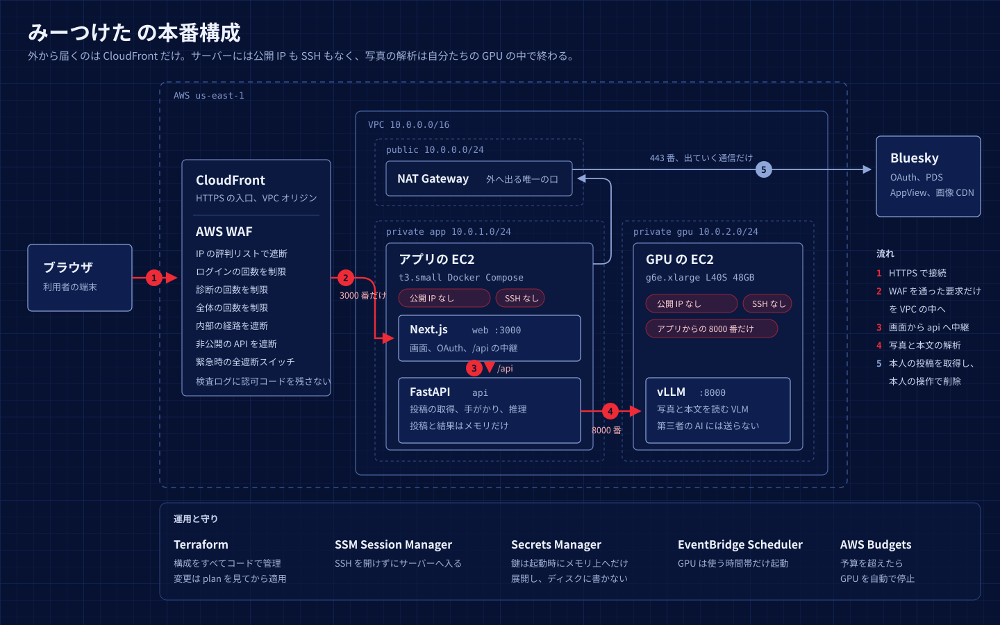

# Kaizen Sprint での進化（Hack Day → Award Day）

[README](../README.md) の「Kaizen Sprint での進化」の詳細です。

Hack Day 後は、「実際の利用者が安心してログインし、診断から対策まで終えられること」を目標に改善しました。ここでは、実機で確かめたことと、まだ確かめていないことを分けて書いています。

## ① Bluesky OAuth 対応

Hack Day 版は App Password でのログインでしたが、Bluesky の公式 AT Protocol OAuth SDK（[`@atproto/oauth-client-node`](../web/src/lib/server/oauth.ts)）によるログインを追加しました（PR #126〜#130）。

* **パスワードをアプリに入力しない。** 利用者は Bluesky 側の画面で許可するだけです。`AUTH_MODE=oauth` では、パスワード入力欄とパスワード用 API を無効にします。
* **権限を絞る。** 要求するスコープは本人確認と投稿の削除（`atproto repo:app.bsky.feed.post?action=delete`）だけです。投稿の作成や編集の権限は求めません。PKCE・PAR・DPoP・トークン更新は SDK に任せています。
* **トークンをブラウザに渡さない。** OAuth のトークンは Next.js サーバーのメモリに置きます。ブラウザに渡すのは、ランダムなセッション Cookie と、認可の開始を結び付ける短命の Cookie だけです。セッションは 30 分（`SESSION_TTL_MINUTES`）かログアウトで失効し、同じアカウントで再ログインすると古いセッションは無効になります。
* **AWS 環境での認証。** CloudFront・WAF 経由で認可のコールバックを受け、Web と API の間は起動ごとに作る内部共有秘密で認証します（[`infra/terraform/`](../infra/terraform/README.md)）。AWS 上での試験で見つかった、Cookie が消える不具合（#128）、OAuth セッションで診断を開始できない不具合（#129）、内部の削除経路がビルドされない不具合（#130）を修正しました。

## ② 対策まで行える診断体験

Bluesky では、次の一連の流れを実アカウントで動かしています。

```text
本人の投稿を取得 → 画像・本文から手がかりを抽出 → 投稿を横断して推論 → 根拠を表示
  → 投稿を仮に外して再計算 → 本人が確認した投稿だけを実削除 → 残った投稿で再診断
```

削除は、利用者が投稿を選び、確認ダイアログで確定した場合だけ実行します。API は、削除対象が本人のアカウントの投稿で、かつ直前に診断した投稿であることを確かめてから削除します。

結果の画面では、次のように推定の理由と対策の効果を確かめられます（#152〜#154・#160）。

* **推理の流れをたどる。** 捜査ボードの推定ごとに「推理の流れをたどる」を開くと、「根拠の投稿 → その投稿から取った手がかり → 推定とメモ」の順に並びます。使うのは本人の投稿と手がかりだけで、外の Web は見ません。
* **確からしさが弱い推定に印を付ける。** 推定ごとに、根拠の手がかりの確からしさを 1 − ∏(1 − c) で合成します。画面に数字は出さず、0.8 未満の推定にだけ「確からしさ：弱い」の印を付けます。
* **削除前後の項目数を見せる。** 「消したらどうなる？」の試算や削除の結果に、推定できた項目の数を「N → M」と大きく表示します。同じ項目に推定が2つあっても1と数えます。
* **削除した投稿は、開き直しても候補に戻らない。** 削除できた投稿はセッションに記録し、画面を開き直したときの推定・削除候補・「消したらどうなる？」の計算から除きます（#147・#149）。プロフィール推定も、消した投稿を根拠から除いて出し直します（#197）。
* **投稿前の下書きを確かめる。** 診断の結果が出たあと、これから投稿する本文と写真を、診断で読んだ過去の投稿の手がかりと照らし、重なる手がかりを示します。モデルに読ませるのは下書きの1件だけで、診断と同じ同時実行の枠とモデルの事前確認を通します（#196）。

**ログインなしの体験デモ（`/demo`、#156）。** トップの「ログインせずに、架空のアカウントで試す」から開けます。リポジトリにある架空アカウントの投稿と手がかり（[`demo_observations.json`](../eval/fixtures/demo_observations.json)）を同じ推理にかけ、推定・根拠と、削除候補を「消したらどうなる？」で試せます。モデル・Bluesky・セッションには接続せず、削除の操作もありません。画面の一番上に「架空のアカウントです」と常に表示します。

> Bluesky から投稿を削除しても、第三者が保存したスクリーンショット、引用、すでに他のサービスに複製されたデータまで消えるわけではありません。「みーつけた」が示すのは、今後この投稿から推定される範囲を減らせるかどうかです。

## ③ 複数 SNS への拡張

診断の中心（手がかりの抽出・推論・仮除外）は、共通の投稿データ構造（[`Post`](../common/src/tkb_common/schemas.py)）を入力にしています。そのため、SNS ごとに「認証して本人の投稿を取得し、`Post` に変換する部分」を用意すれば、同じ推論エンジンを使えます。

本番の扱いは [`infra/aws.env.example`](../infra/aws.env.example) の設定に合わせて書いています。

| | Bluesky | Threads | X |
| --- | --- | --- | --- |
| 本番での位置付け | 公開（Award Day の実演対象） | テスター限定（Meta に Threads Tester として登録したアカウントだけ） | 合成投稿のデモだけ |
| 認証 | 公式 SDK の OAuth（本人確認と投稿の削除だけ） | Threads の OAuth（`threads_basic` だけ） | OAuth 2.0 PKCE を実装。用途承認・費用承認などのフラグがそろうまで閉じる |
| 投稿の取得 | 本人の投稿（写真・本文、直近30件） | 本人の投稿の本文（最大30件。画像・動画は取らない） | 承認後も、本人の投稿を最大5件取得して原文のまま表示するだけ |
| 診断 | 写真と本文から推定・プロフィール推定・仮除外・再診断 | 本文を Bluesky と同じ vLLM で読み、推定・プロフィール推定・仮除外・再診断（#199・#200）。読めなかった投稿は外して続ける（#203）。AI を使わない固定ルールのセルフチェックもある（#178） | 合成投稿だけ：地名・駅名・曜日・時刻・学校名をルールで抜き出し、件数と根拠、仮除外の前後を見せる。実投稿は抽出・推定しない（#201） |
| 削除 | 本人の確認後に実削除・再診断 | なし（仮除外のみ） | なし |
| 一般公開までの課題 | — | Meta の App Review（[提出資料](threads-app-review.md)） | X の用途承認と費用承認（[承認後の手順](x-poc.md)） |

* **Threads（[`routes/threads.py`](../api/src/tkb_api/routes/threads.py)）。** 画面は日本語と英語を切り替えられます（#183）。Meta からの認証解除・データ削除の依頼は署名を検証し、その人のセッションと結果をすぐ消します。
* **X（[`routes/x.py`](../api/src/tkb_api/routes/x.py)）。** X の開発者規約は個人のプロファイリングを制限しているため、実投稿からの推定は行いません。実連携は、承認フラグ・資格情報・クエリログの伏せ字がすべてそろわない限り閉じます（#181）。X の表示要件に合わせた投稿表示（#186）、地名・駅名を数えずにハイライトする表示（#187）、1日の取得件数の上限（#182）を入れ、偽の X API で OAuth から破棄までを CI の Playwright で通しています（#184）。

## ④ CPU/GPU の2方式での検証

| 経路 | 対象 | モデル・実行環境 | 位置付け |
| --- | --- | --- | --- |
| GPU | 画像を含む投稿・本文 | VLM（AWS の非公開 GPU サーバー上の vLLM） | 本番の既定。Threads の本文も既定でこちら（`THREADS_TEXT_BACKEND=vlm`） |
| CPU | 本文だけ | Qwen3 4B（`qwen3:4b-instruct`）を Ollama で実行 | 検証用（`TEXT_BACKEND=ollama`・`THREADS_TEXT_BACKEND=ollama` で切り替え） |

CPU だけの環境でも、本文から手がかりを抽出し、既存の推論エンジンにつなげられることを確認しました（[`ollama_client.py`](../detect/src/tkb_detect/ollama_client.py)、[手順と評価](local-ollama-text.md)）。GPU を常に動かさずに済むため、軽量化と運用コスト削減の可能性があります。

一方、架空の投稿12件で比べると、Qwen3 4B は正解13件のうち9件を抽出し、余計な抽出も6件ありました。本番の既定にするには、精度の改善と本人投稿での評価が必要です。なお、この経路ではモデルが返した引用が投稿本文に実際に含まれるかを確かめ、含まれない手がかりだけを捨てて残りを使います。

## ⑤ AWS GPU での実測

AWS の GPU（g6e.2xlarge、vLLM）で診断を実行し、処理時間を測りました。

| 対象 | 処理時間 |
| --- | ---: |
| Threads 本人テスト投稿3件 | 約3.5秒 |
| Threads 架空投稿3件 | 約4.9秒 |
| X 架空投稿2件 | 約3.3秒 |

参考として、CPU 版（Qwen3 4B）で Threads 本人投稿3件を再実行したときは約16.5秒、推論プロセスの観測メモリは約3GiBでした。

これらは投稿の内容・件数・測定条件が異なる、それぞれ1回の測定です（Threads・X の診断経路を今の形に変える前の測定）。GPU と CPU の厳密な性能比較や、精度の優劣を示すものではありません。

## ⑥ AWS への本番移行とセキュリティ検証



**なぜ移行したか。** 開発・検証は手元の PC や共有の GPU でも動かせますが、本人の投稿と写真を扱うサービスを一般の人に使ってもらうには、「誰が・どこから・何に届くか」を設計で決めておく必要があります。そこで、公開の入口、アプリ、モデルサーバー、秘密の値、費用の上限まで AWS 上に作り直し、そのうえで検査しました。

**構成と役割**（詳細は [`infra/terraform/`](../infra/terraform/README.md)、[移行設計](aws-migration.md)）

| 部品 | 役割（防ぎたいリスク） |
| --- | --- |
| CloudFront | HTTPS の唯一の入口。アプリのサーバーをインターネットに直接さらさない |
| WAF | ログイン・診断・全体のレート制限、Next.js の内部経路（`/__internal`）の遮断など。大量アクセスや総当たり、内部経路への直接の要求を入口で抑える |
| EC2（アプリ） | パブリック IP なし。CloudFront 経由の通信だけを受ける |
| EC2（GPU） | パブリック IP なし。アプリのセキュリティグループからの通信だけを受け、キーのない要求は拒否する。写真と本文が外部へ出ない |
| Secrets Manager | モデルサーバーの API キーを `.env`・Terraform の状態・ログに置かない |
| SSM | SSH を開けずに管理する。22番ポートの受け入れ規則は作っていない |
| AWS Budgets | 月$100の予算。$10ごとにメール通知し、$80で GPU を自動停止する |

* **Infrastructure as Code。** ネットワーク、セキュリティグループ、WAF、IAM、予算、スケジュールを Terraform で定義しています。手作業の設定漏れを減らし、変更を差分（plan）で見てから反映できます。
* **AI 推論サーバーの保護。** モデルサーバーはプライベートサブネットに置き、外向きの通信は443に絞っています。EC2 は IMDSv2 必須・hop limit 1 にして、アプリのコンテナが乗っ取られてもインスタンスの認証情報に届かないようにしました。キーはホストの起動スクリプトが読み、メモリ上のファイルでコンテナに渡します。
* **GPU の費用管理。** GPU は常時動かさず、時間帯に合わせて起動・停止します。2026-11-10 に、公開時間でアプリが診断を断らない方針にしたため（`PUBLIC_WINDOWS=[]`）、**GPU が動いている間は誰でも診断できます**。止まっているときは「準備中」になります。
* **12カテゴリの検査（アプリ）。** 認証境界、セッション、認可、入力検証、SSRF、プロンプトインジェクションなどを、ローカルの実インスタンスで検査しました（2026-11-06、[総合報告書](security/REPORT.md)）。致命的な欠陥は見つからず、許可リスト方式への変更と投稿 URI 検証の強化を行いました。
* **AWS 本番への追加検査（2026-11-10）。** 公開 URL への読み取りだけの検査（[カテゴリ13](security/13-prod-interim-2026-11-10.md)）と、AWS 構成の読み取り専用の実測（[カテゴリ14](security/14-prod-aws-2026-11-10.md)）を行いました。アプリ・GPU に公開 IP がないこと、インバウンドが想定のセキュリティグループ参照だけであること、コンテナからインスタンスの認証情報を取れないこと、web・api が root で動いていないことを確かめました。

**実際に見つかった問題と対応**

| 問題 | 対応 | 状況 |
| --- | --- | --- |
| 画面に CSP がなく、`x-powered-by` でフレームワークが分かる（中・情報） | `frame-ancestors`・`object-src`・`base-uri` を制限する CSP を付け、`x-powered-by` を消した（#139） | main にマージ済み。AWS 本番にも反映済み（再検査は未実施） |
| 診断前の確認が OCR を見ておらず、OCR だけ停止していると診断が失敗し、1日3回の枠を消費する | 事前確認に OCR の応答を追加（#138） | main にマージ済み。AWS 本番にも反映済み（再検査は未実施） |
| 検査記録の整理 | 13・14の報告を公開用に伏せ字で追加（#137） | main にマージ済み |

マージと AWS 本番への反映は別の作業です（反映にはアプリの EC2 でイメージを作り直します）。

**Award Day に向けて追加した防御**（検査の指摘ではなく、コードの見直しで足したもの）

| 内容 | 実装 | 状況 |
| --- | --- | --- |
| ログアウト時に、Bluesky 側で OAuth トークンを失効させる。セッションの期限（既定30分）が来たときも同じ処理を通す。失効に失敗しても、サーバーのメモリからは必ず消す | 公式 SDK の `revoke` を呼ぶ（[`oauth.ts`](../web/src/lib/server/oauth.ts)、#151） | main にマージ済み。自動テストで確認 |
| 削除・ログアウト・閲覧リンクの作成と取り消しは、`Origin` が自サイト（`CORS_ORIGINS`）の要求だけを受け付け、ほかは403にする。Cookie の `SameSite=Lax` に加えた確認 | 共通の依存関数（[`origin.py`](../api/src/tkb_api/origin.py)、#157）。X・Threads の確認も同じ関数にそろえた | main にマージ済み。自動テストで確認 |
| Next.js の内部経路 `/__internal` を、WAF で遮断する。これまでは、CloudFront の既定の設定が GET・HEAD・OPTIONS しか通さないために届かなかっただけだった | WAF のルール `block-internal`。URL を2回デコードしてから比べる（[`edge.tf`](../infra/terraform/edge.tf)、#158） | main にマージ済み。`terraform validate` は未実施 |

この3件も、AWS 本番への反映と、反映後の確認は別の作業です。

**未検証・残課題**（合格とは扱っていません）

* 13で見つかった、HSTS の `includeSubDomains` なし（低）と、OAuth コールバックが異常時も200を返す点（低）は、対応する PR がありません。
* #139 の CSP は `script-src` を縛っていません。Next.js のインラインスクリプトを使うためで、nonce による強い CSP は今後の課題です。
* 未実施：GPU 稼働時のモデルサーバーと OCR の応答、リクエスト時のログに秘密情報が出ないこと、OAuth の state・Cookie 属性・ログアウト、内部経路が外から叩けないこと、削除の拒否、閲覧リンクの期限と推測のしにくさ。AWS 上でこれらを確かめる再試験を予定しています。
* ログアウト時のトークン失効（#151）は自動テストで確かめましたが、実際の Bluesky の認可サーバーで、失効後に同じトークンが使えなくなることはまだ確かめていません。
* Threads は、テスターの実アカウントで本番の認可 → 投稿取得 → 診断 → ログアウトを通した記録がまだありません（[threads-browser.md](threads-browser.md)）。
* ホストで sshd が起動しています。セキュリティグループに22番の規則がないため外部から届きませんが、記録しています。

これらは「確かめた範囲」の記録であり、脆弱性がないことの証明ではありません。

## ⑦ Kaizen Sprint で追加した技術

* **Bluesky の AT Protocol・OAuth の活用**  
  公式 SDK で OAuth を実装し、要求する権限を本人確認と投稿の削除に絞りました。OAuth 方式では、投稿の取得は本人の DID で公開 AppView から行い、削除は OAuth セッションを持つ Next.js サーバーからだけ実行します。実装は [`oauth.ts`](../web/src/lib/server/oauth.ts)、[`auth/callback`](../web/src/app/auth/callback/route.ts) にあります。

* **複数 SNS で共通に使える投稿データ構造**  
  Threads と X の投稿も共通の `Post` 型に変換し、手がかりの抽出から仮除外までを Bluesky と同じ処理で動かします。認証・取得・利用規約への対応は SNS ごとに分けています。

* **公開データを「X は Y」の知識として使う推定**  
  避難所・バス停・学区・法人番号の表を、本人について調べるためではなく「投稿で見えた X は Y にある」という一般的な知識として使い、投稿をまたいだプロフィール推定の根拠にします（[`open_data.py`](../engine/src/tkb_engine/open_data.py)、[`open_data_bus.py`](../engine/src/tkb_engine/open_data_bus.py)、[`child_school.py`](../engine/src/tkb_engine/child_school.py)）。根拠には出典を出します。

* **推定の確からしさと推理の流れの表示**  
  推定ごとに、根拠の手がかりの確からしさを 1 − ∏(1 − c) で合成します（同じ手がかりは2回数えません。実装は [`rules.py`](../engine/src/tkb_engine/rules.py) の `combined_confidence`）。画面では、弱い推定にだけ印を付け、推定ごとに「投稿 → 手がかり → 推定」の順で根拠をたどれます（[`ReasoningChain.tsx`](../web/src/components/conclusion-board/ReasoningChain.tsx)）。

* **GPU・CPU の推論経路の分離**  
  `TEXT_BACKEND` で本文の処理先を切り替えます。既定は VLM で、本文用のモデルが使えない場合も既定の VLM へ自動で送り直すことはしません。

* **AWS 上の非公開 GPU とアクセス制御**  
  アプリと GPU の EC2 はどちらもパブリック IP を持たない非公開サブネットに置き、公開は CloudFront＋WAF からアプリへの経路だけです。GPU のモデルサーバーは、アプリのセキュリティグループからの通信だけを受け付け、API キー（Secrets Manager で管理）がない要求を拒否します（`/v1/models` がキーなしで401を返すことを確認）。構成は [`infra/terraform/`](../infra/terraform/README.md) にあります。
